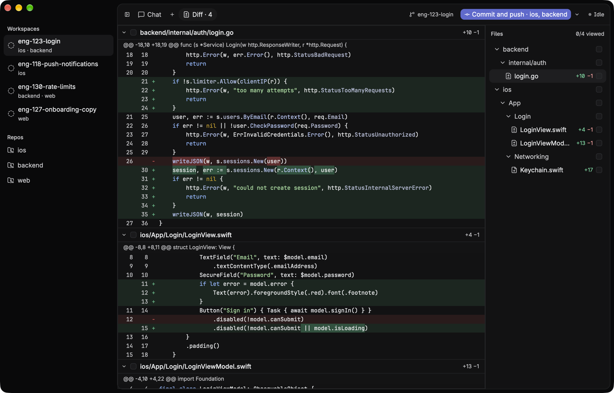
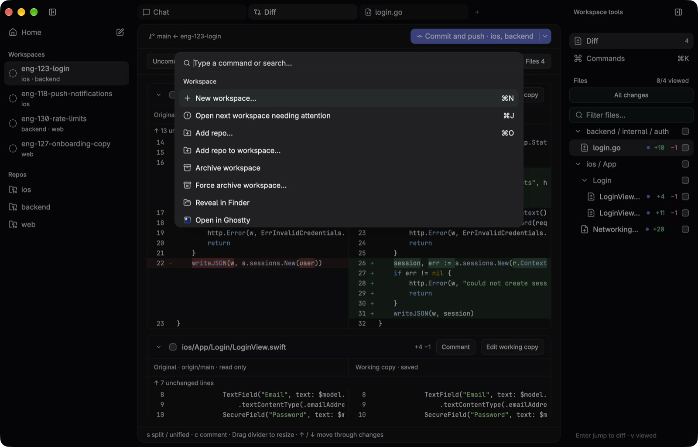
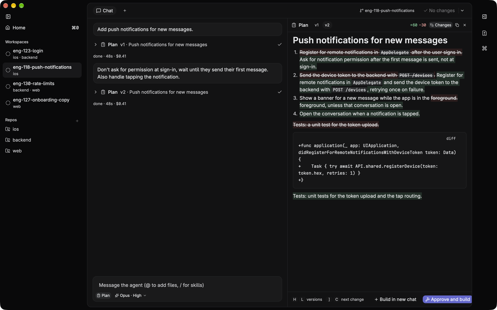
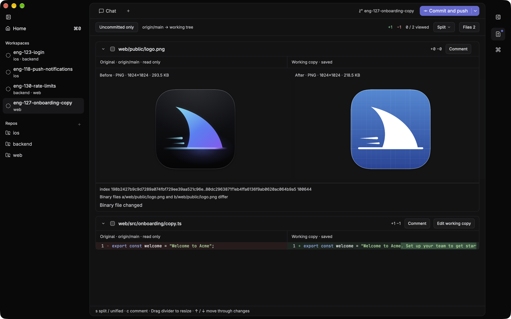
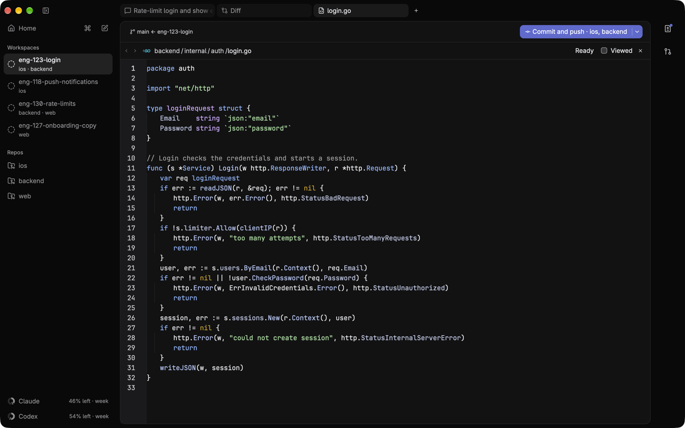
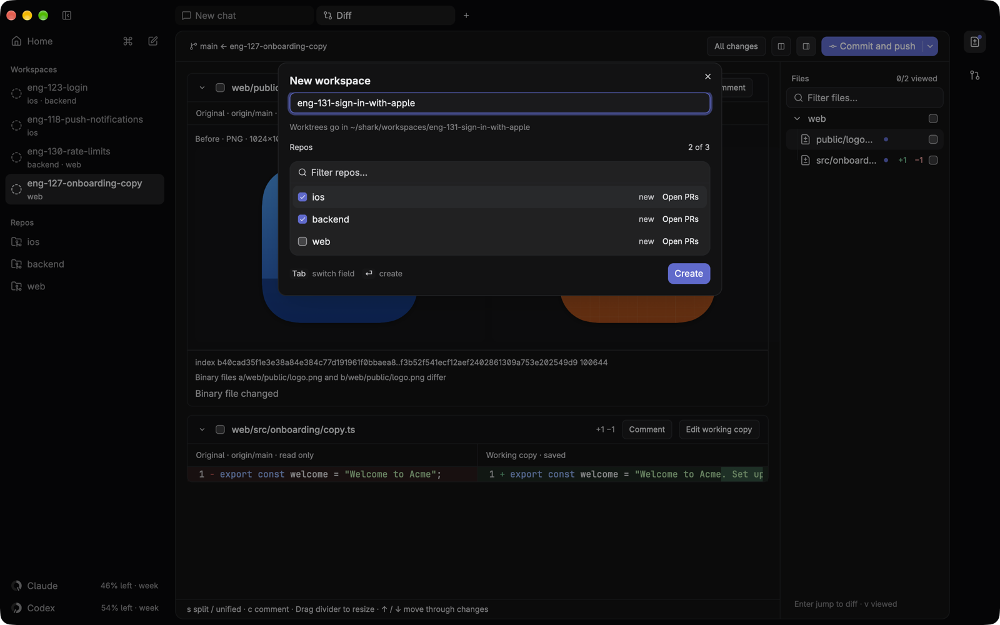
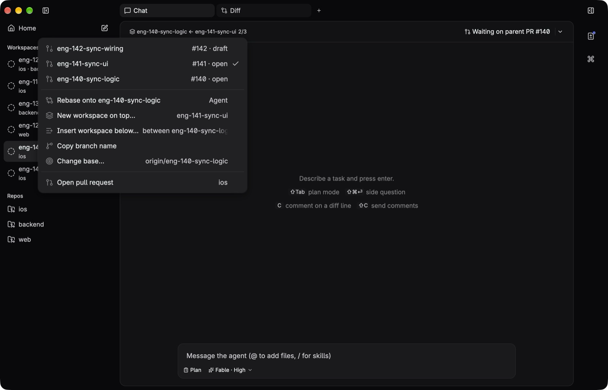

# Shark

A fast, native macOS app for running coding agents on tasks that span several repos.



## Fast and native
Shark is built on [GPUI](https://www.gpui.rs), Zed's GPU-rendered UI framework, running on Metal. It is not an Electron app. Everything is in the `cmd-k` palette, which shows each command's shortcut, and an optional Vim mode adds Vim keys to the editor, the composer and every list. The UI stays responsive while agents work. Chat history loads off the UI thread, git status runs with `--no-optional-locks` so it never takes the agent's `index.lock`, and `ctrl-c` interrupts a turn while the claude process stays warm.



## Account usage
The navigation footer lists Claude and Codex by name, each with a progress ring and the share left of its lowest known allowance (“68% left”); the collapsed rail shows the ring above the name. Rings are grey, amber at 20% or below, red at 5% or below. A tick on each ring and panel bar marks the even pace: what would be left if the window were used evenly, so halfway through a weekly window it sits at 50%. A ring that reaches past its tick is ahead of the limit. Click either ring, or use **Show usage** in `cmd-k`, for all allowances and reset times in your local timezone. Shark checks at startup and every five minutes while its window is active, including when the detail panel is closed. Returning to Shark refreshes overdue data; opening details and Refresh also fetch immediately. Queries use your signed-in CLIs without sending a prompt; results stay in memory. Outdated results are muted, and a neutral Usage button remains when neither provider has allowances. Claude’s experimental usage contract may become unavailable after a CLI update.

## Version-controlled plans
In plan mode (`shift-tab`) the agent, Claude or Codex, reads and plans but edits nothing. Each plan it proposes is saved as a new version. The plan pane shows what changed since the previous version: added words in green, removed words struck through in red, changed code blocks as diffs. Reply in the chat to revise the plan, step through versions with `h`/`l`, and press `a` to approve and build.



## Features and artifacts
A **feature** is a capability that opens an **artifact** in a workspace tab. An artifact is the view you work in: an AI chat, a diff viewer, or a file editor. Each artifact keeps its own controls together.

The fixed **Features** rail on the right contains **Differ** and **Git**. Git opens a PR workspace for reviewing and editing descriptions, reading comments, replying to review threads, and resolving or reopening them. Select Differ to open the workspace's Diff artifact, or focus that tab if it is already open. Its changed-files tree lives inside the artifact; switching to a chat or file hides the tree with the diff. New workspaces still start with a chat.

## Review the diff like a PR
The diff shows the original and the working copy side by side, across every repo of the workspace, against the base or (Uncommitted only) against `HEAD`. Changed images show before and after, and videos play inline. Press `i` to edit the working copy in place, or `c` to comment on a line, with an optional suggested change. `shift-c` sends the comments you tick to the agent as one review; each one is then tracked as sent, addressed or outdated. A comment can also go to the open GitHub PR as a note or a Comment review.



## Full-width file tabs
Open a file from the Diff artifact's tree or `cmd-p` to edit it across the central area. Chat and Diff stay one tab away, and Command-click keeps additional files open. A small dot in the file tree marks uncommitted changes; right-click a file and choose **Discard uncommitted changes…** to restore its last commit after confirmation. New files are deleted when discarded.

Drag chat, Diff, and file tabs into any order. Tabs stay inside the strip and move horizontally; workspace and section rows stay inside the sidebar and move vertically. Neighboring items animate into place while you drag. Dropping inside saves the order; releasing outside cancels. Each workspace remembers its order and reopens file tabs in the background when you return or restart. Unsaved edits still require saving or discarding before you leave; restored files use their contents on disk. Files that cannot be reopened are reported together and retried on the next visit. Drag empty header space to move the window; tab drags only reorder tabs.



## Multi-repo workspaces
One workspace = one task = one git worktree per repo on a shared branch, e.g. `~/shark/workspaces/eng-123-login/{ios,backend}`. A single agent works across all of them. The diff is combined, PRs are cross-linked and merge in an order you set, and one git button shows the next step for every repo: commit, push, fix checks, address review, merge.



## Stacked PRs
A workspace can start from another branch or an open PR instead of `main`: its PR then targets that branch. For example, a backend change and an iOS feature in three PRs: logic, UI on top of logic, wiring on top of UI. The branch button in the header shows the base (`logic ← ui`) and the branch's place in its stack (`2/3`). Its menu lists the stack, so you can jump to the workspace or PR above or below, start a new workspace on top, insert one in between, or rebase onto the parent. Each repo of a workspace has its own stack, so the iOS repo can be stacked while the backend repo targets `main`. When a parent PR merges, the git button moves the PR onto the parent's base, and the agent rebases only the branch's own commits, also after a squash merge.



## Install
```sh
brew tap KaffeDiem/shark https://github.com/KaffeDiem/shark
brew install --cask KaffeDiem/shark/shark
```
Or [Download Shark 0.1.12](https://github.com/KaffeDiem/shark/releases/download/v0.1.12/Shark-0.1.12.dmg) (Apple Silicon), open it and drag Shark to Applications. The app isn't notarized: on first launch, open it, then allow it in System Settings → Privacy & Security → Open Anyway, or run `xattr -dr com.apple.quarantine /Applications/Shark.app`.

Needs `git`, `gh` (logged in) and `claude` on your login shell's PATH. For Codex models (GPT-6.1 Sol, GPT-6 Astra), also `codex`, logged in with `codex login` (a ChatGPT plan works). Codex chats have no side questions. They have a **Fast** toggle for Codex's faster service tier, which uses more of your plan's usage.

## Quick start
Shark opens on Home (`cmd-0`) when no workspace is open. It shows what's missing (git, gh, claude), every workspace grouped by what it needs from you (Needs you, Running, Unread, Idle), and a Get started checklist (one line once you have workspaces; Hide Get started in `cmd-k` removes it). Type what you want to build in its box and press `enter` to start a workspace with that as the first message, or press `tab` to ask Shark how to do something (a one-off Haiku answer from this README and the live keymap).

1. Choose **Add repo** in `cmd-k`. `cmd-n`, tick the repos, and name the branch. `enter` creates the workspace.
2. `shift-tab` for plan mode. Revise the plan in the chat, then `a` in the plan pane to build.
3. `cmd-shift-d`, or **Differ** in the Features rail, opens the Diff artifact with its changed-files tree. While Diff is active, `cmd-alt-b` shows or hides that tree. Click a chat tab to go back. `c` on a diff line leaves a comment, and `shift-c` sends the review to the agent.
4. Create or update PRs (`cmd-k` or the git menu) opens linked PRs. The git button (top right) takes it from there.

## Keys
| Where | Keys |
|---|---|
| anywhere | `cmd-k` palette · `cmd-,` settings · `cmd-0` Home (again, or `esc` on Home, goes back to the workspace) · `cmd-n` new workspace · `cmd-shift-o` open workspace (type a workspace or repo name; Enter opens the best match, or the most recent other workspace with no query; Escape closes) · `cmd-o` app switcher (hold `cmd`, tap `o` to cycle; `cmd-shift-o` reverses while open; release `cmd` to open; `esc` cancels) · `cmd-t` new chat · `cmd-w` close current tab · `cmd-shift-t` reopen closed chat · `ctrl-tab`/`ctrl-shift-tab` next/previous tab in the saved order · `cmd-shift-]`/`[` next/previous chat · `ctrl-1…9` open the Nth visible tab (hold `ctrl` to see the numbers) · `cmd-1…9` open the Nth workspace (hold `cmd` to see the numbers) · `cmd-j` next workspace that needs you · `cmd-p` open any file · `ctrl-c` interrupt the shown chat's turn, again to stop the process (not in the editor) · `cmd-alt-←/→` previous/next pane (Vim: `ctrl-w h/l`) · `cmd-b` sidebar ↔ icon rail · `cmd-shift-d` show the diff · `cmd-shift-g` show Git · `ctrl-cmd-v` Vim mode on/off (also Settings › General) · `cmd-/` model and thinking menu (type a letter to jump, again to cycle) · `cmd-shift-f` fast mode on/off (Codex chats) · `cmd-shift-.`/`cmd-shift-,` thinking level up/down · `ctrl-cmd-1…6` Fable/Opus/Sonnet/Haiku, then GPT-6.1 Sol/GPT-6 Astra · `cmd-q` quit · `cmd-h` hide · `cmd-m` minimize |
| sidebar, transcript | `↑/↓` `home`/`end` `pageup/pagedown` · with Vim mode `j/k` `gg` `G` `ctrl-d/u`, and `g t`/`g T` next/previous chat · `enter` open / toggle tool output (`o` too in the transcript) · `y` copy the selected message, reply, tool output or plan · `i`/`a` → composer |
| sidebar sections | New section, Rename section, Change section icon…, Delete section (its workspaces stay) in `cmd-k` or on right-click · new sections are named in place (`enter` saves, `esc` cancels) · `m` move workspace to a section · `←/→` (Vim: `h`/`l`) fold/unfold · `enter` on a header toggles it |
| composer | `enter` send (queues while the agent runs) · `cmd-enter` send now, steering the running turn · `cmd-shift-enter` ask as a side question · `↑` on the first line → queue · `shift-enter` newline · `esc` → normal mode · `@` add a file or folder (`repo/` to pick the repo) · drop files from Finder anywhere on the chat (a dashed overlay shows while they hover), or `cmd-v` copied files or an image, to attach them · `/` skills and commands at the start · `#` a PR from any repo, sent as its URL (by number, title, author or branch; `enter` picks only an exact number or a word match, so `#endif` stays text) · in the menu `↑/↓` `enter`/`tab` `esc` · key hints under the composer show only while a turn runs |
| queue | `↑/↓` `home`/`end` (Vim: `j/k` `gg` `G`) · `enter` send now · `e` edit (`enter` puts it back) · `d`/`backspace` delete · `alt-↑/↓` move up/down (Vim: `shift-k/j`) · `esc`/`i`, or `↓` past the last row → composer |
| Home | `↑/↓` `home`/`end` (Vim: `j/k` `gg` `G`) · `enter` open the workspace · `cmd-backspace` archive it (also in the sidebar) · right-click it for more · `i`/`a` → the prompt · in the prompt `enter` new workspace with it as the first message (Ask Shark: ask), `tab` new workspace ↔ Ask Shark · `esc`/`ctrl-c` stop an answer |
| side question | `esc` dismiss · `c` copy the answer · `enter` put the answer into the composer |
| agent questions | `1`–`9` pick (tick in multiple choice) · `↑/↓` move · `space` tick · `enter` next / send on the last · `esc` from "Something else…" back to the choices, else answer in the chat instead · `↑` from the composer's first line back to the card |
| `cmd-k` | every command, with its shortcut on the right: workspaces (archive, force archive, add a repo, reveal in Finder, open in Terminal or any other installed app, copy path/branch; only with a workspace open or under the cursor), chats, plan, files and diff, git (next step, git menu, fetch, create/draft/merge/open PRs, merge order, stacks: branch menu, new workspace on top, insert below, rebase onto parent, go to stack), sections, view (Go to Home, Hide Get started), settings · the Help menu has Keyboard shortcuts (this palette), the README and Report an issue · type to filter; extra words match too (`pr`, `github`, `discard`) |
| new workspace | `enter` create (in branch) · `tab` branch ↔ repo filter · type to filter · `enter` tick match · `space` tick/untick highlighted · `cmd-b` branches · `cmd-p` open PRs · in those lists `enter` checks the branch out (reviews the PR) and `alt-enter` bases the new branch on it · `cmd-r` refresh sources · `cmd-enter` create · last-used repos start ticked |
| sidebar mouse | right-click a workspace: open, move to section, reveal in Finder / open in an app / copy path (per repo), copy branch, open PRs, archive · drag a workspace onto a section header to move it in (onto Workspaces to ungroup), or onto another workspace to take its place · drag a section header onto another to reorder sections · hover Workspaces for **+** new section, or right-click it or the empty space below · click a section header to fold it; right-click it to rename, change icon, delete · click a repo: new workspace with it ticked · hover Repos for **+** add repo, or drag folders from Finder onto the sidebar |
| plan mode | `shift-tab` (composer, transcript, queue, plan) plan mode on/off · Show or hide plan, Approve plan and build, Build plan in a new chat in `cmd-k` · in the pane `↑/↓` scroll (Vim: `j/k` `gg` `G` `ctrl-d/u`) · `←/→` (Vim: `h/l`) older/newer version · `alt-↓/↑` (Vim: `]c`/`[c`) next/previous change · `d` changes on/off · `a` approve · `n` build in a new chat · `i` → composer · `y` copy the shown version · `enter` on a transcript **Plan** row opens that version |
| settings | `ctrl-tab`/`ctrl-shift-tab` next/previous page (General, Appearance, Prompts) |
| diff | `cmd-alt-b` changed-files tree on/off (only while Diff is active) · `↑/↓` `home`/`end` move the line cursor (kept across refreshes); with Vim mode `j/k` `gg` `G` `ctrl-d/u` move it, the arrows scroll and `h/l` scroll sideways · `alt-↓/↑` changes · `]c`/`[c` comment threads (changes when there are none) · `}`/`{` files · `v` viewed / `o` open the cursor's file · `s` split/unified · `r` refresh · `p` play/pause the file's video · viewed checkbox in each file header · `i` edit the working copy in place (`cmd-s` save, `esc` back to reviewing) · `c` comment on the cursor line or selected lines (`c` on a pending one edits it), `cmd-shift-s` in the comment adds a suggested change, `cmd-enter` adds it · on a thread: `e` edit, `x` delete, `d` view the change, `r` resolve, `shift-r` reopen · `shift-c` send review |
| Git | `cmd-s` save the description or post the active comment/reply to GitHub · `esc` keep the draft and return to the conversation · Read full text opens long messages in a read-only editor with `cmd-f` search and copy |
| send review | `space` tick/untick · `↑/↓` (`j/k`) · `enter` jump to the thread · `cmd-enter` send · `esc` close |
| file tree (inside Diff) | `↑/↓` `home`/`end` (Vim: `j/k` `gg` `G` `ctrl-d/u`) · `enter` show the file in the diff / toggle folder · type in Filter files… to narrow it · `←/→` (Vim: `h/l`) collapse/expand · `v` viewed (on a folder: every file in it) · `o` open in editor · `cmd-click` open a file in an additional tab (an already-open file is selected) |
| editor | `cmd-s` save · `cmd-w` close · `esc` focuses the workspace sidebar without changing tabs · with Vim mode: motions `hjkl w b e 0 ^ $ gg G { }` with counts, `i a I A o O` (`esc`/`ctrl-c` back to normal), `x dd yy cc D C p P J r ~`, `d/c/y/>/<` + motion, `v`/`V`, `u` / `ctrl-r`, `/ n N`, `:w`; the composer gets the same keys and starts in Insert, `esc` enters Normal and a second `esc` leaves for the transcript |

## How it works
- **Workspace creation:**
  - For each repo, `git worktree add --no-track -b <branch> <ws>/<repo> origin/HEAD`. Every repo is checked first, so a refusal leaves nothing behind: the branch is already checked out somewhere, or a local branch of that name exists that origin doesn't have (usually left from an archived workspace; pick another name or rename it). Offline or without an origin, the local branch is used.
  - A branch that only origin has starts at `origin/<branch>` (still `--no-track`); one both have uses the local branch.
  - Based on another branch or PR (`alt-enter` in a repo's branch or PR list, or New workspace on top… / Insert workspace below… in the branch menu), the new branch starts at `origin/<parent>` and its base is `origin/<parent>`. The parent must be on GitHub and in the same repo (a fork's PR can't be a base), and the branch name must be new. The commit it starts on is kept as `branch.<b>.shark-parent-tip` in the repo's git config.
  - Started from Home's prompt, the dialog sends that text to the agent once the workspace is open.
  - **Add repo to workspace…** (`cmd-k`) adds a worktree for another repo on the same branch the same way, rewrites the root `CLAUDE.md`, and the agent is told about it with the next message.
  - Gitignored files that match `.worktreeinclude` (default `.env*`) are copied into the new worktree.
  - A root `CLAUDE.md` is written that lists the repos (with each one's GitHub URL, so a PR URL maps to its folder) and `@`-imports each repo's own CLAUDE.md.
- **Open in an app:** the menus and `cmd-k` list every app macOS has registered to open folders (terminals, editors, git clients such as Fork), plus JetBrains IDEs, Android Studio and others that open folders without registering for them, each with its own icon, found once at launch. Terminals and editors open the workspace folder or a repo, git clients a repo, and Xcode an `.xcworkspace`, else `.xcodeproj`, else `Package.swift` (only in a repo without a project), in a repo or two folders down; Xcode shows only where there's one. With several repos or projects, `cmd-k` asks which.
- **Menu bar:** the Shark, File, Edit, View and Window menus run the same actions as the keys and the palette.
- **Restart:** the open workspace and tab (Chat or Diff, or Home over it) are saved in `state.json` and reopened at launch, on the chat tab last shown. With nothing to reopen, Shark starts on Home.
- **Archive:** checks every repo up front (uncommitted or untracked files, locked worktrees, submodules), so it can't stop halfway. Force-archive removes dirty worktrees and submodules but not locked ones. Messages to any of the workspace's chats are refused while it is being archived, and it refuses while any chat runs.
- **Tab close controls:** Chat, Diff, and File tabs show × only while that tab is hovered, including in an unfocused window. Tab widths stay fixed; closing a background tab preserves the current view and focus.
- **Chats:** a workspace has one or more chat tabs, each its own claude process, session, model, queue and transcript; they can run at once in the same worktrees. The tab title is the first line of its first message.
  - Drag a chat tab onto another to take its place. The order is saved, the current chat stays open, and `ctrl-1…9` follows the new order.
  - `cmd-w` on a running chat asks before stopping it. A closed chat that had a session can come back with `cmd-shift-t` or "Reopen closed chat…" (the 20 newest are kept); closing the last tab leaves a fresh one.
  - Direct git writes wait for every chat to be idle; agent prompts join the shown chat's queue.
- **Attachments:** files dropped on the chat or pasted into the composer are copied to `<ws>/.context/attachments/` and mentioned as a chip (`@".context/attachments/x.png"`, quoted so names with spaces resolve). A file already in the workspace is mentioned in place; a folder outside it is mentioned by absolute path, not copied. Same name and bytes reuses the copy; same name, other bytes gets ` (1)`. The U+202F in macOS screenshot names becomes a space, and HEIC is converted to JPEG with `sips`. Archive removes them with the workspace.
- **Plan mode** (`shift-tab`, or the **Plan** button in the composer): the chat's claude switches to `plan` with a `set_permission_mode` control request (a new process switches as it starts), so it reads and plans but edits nothing. claude runs with `--permission-prompt-tool stdio`, so its `ExitPlanMode` call asks shark instead of failing: shark keeps the plan as the next version (in `plans/<chat>.json` next to the transcripts) and denies the call, telling claude the user is reviewing it, so the turn ends. Reply in the chat to revise; each revision is a new version. The plan pane shows the newest version with what changed since the one before marked in place: added words green, removed words struck through in red, a changed code block as a `diff` block. **Approve and build** switches back to `bypassPermissions` and tells claude to implement the plan. **Build in new chat** instead opens a new chat tab whose first message is the plan alone, so the build starts without the planning back-and-forth in context; the planning chat keeps its history, with the plan marked approved. Either way the plan pane closes; Show or hide plan in `cmd-k` brings it back. Questions the agent asks (`AskUserQuestion`) get a card; see **Agent questions**. Other tools that ask (`EnterPlanMode`, anything needing approval) are denied with a reason, as headless claude did before. A Codex chat's plan mode is `codex app-server`'s `plan` collaboration mode, sent with each `turn/start` together with a read-only sandbox (shark asks for the server's experimental API, which collaboration modes need). Codex proposes its plan as a `plan` item instead of a tool call, so the turn ends by itself; shark keeps it as the next version the same way. Plan mode's questions to the user (`request_user_input`) get the same card as claude's. Approving sends the next message in the `default` mode with full access again. A switch made mid-turn applies from the next message.
- **Agent questions:** when claude calls `AskUserQuestion` (or Codex's plan mode asks with `request_user_input`), the turn waits and a card opens above the composer, one question at a time: the agent's choices with their descriptions, numbered, and a "Something else…" field. It takes the focus unless you're typing a message; `↑` from the message box goes back to it. `1`–`9` picks and goes on to the next question (in a multiple-choice question it ticks; `enter` goes on), the last question sends the answers, `↑/↓` move, `space` ticks, `enter` in "Something else…" takes your text, and Previous / Skip / Next step between questions (Skip leaves one unanswered). `esc` (or ×) closes it and tells the agent you'll answer in the chat, so it ends its turn; sending a message from the composer does the same, and the message goes once the turn ends. claude gets the answers as the tool's result (`answers` by question, picks and your own text joined with ", "); Codex gets them by question id, your own text as a `user_note:`. The transcript keeps a **Question** row with the answers (a secret answer Codex asks for shows as `••••`), and the activity line reads "Waiting for your answers". While a chat waits on answers, its tab shows a `?` and its workspace is in Needs you ("Question to answer") with a notification.
- **Models and thinking level** (`cmd-/` or the model button in the composer, `ctrl-cmd-1…6`, `cmd-shift-.`/`cmd-shift-,`, or `cmd-k`): every chat has a model and a thinking level, saved with it. The button shows both ("Opus · High"); its menu lists the models, then the levels, each with a check on the current one, and opens on the current level. claude gets `--model` and `--effort` (low, medium, high, xhigh, max; Haiku takes them too), so a new model or level restarts the process at the next send and resumes the session, never mid-turn; side questions use the same. Codex gets the model at thread start and `effort` in every `turn/start` (low to max, plus ultra), from the next message, no restart. A level the model lacks becomes its highest (ultra on Claude is max). Until a level is picked a chat runs at high. New chats (`cmd-t`, a new workspace, the chat that replaces the last closed tab, Build in new chat) start on the model and level last picked in any chat, kept in `state.json`; Fable and high before the first pick. Chats saved on the old CLI default load on the last pick, ones on Codex's default on GPT-6.1 Sol.
- **Fast mode** (Codex chats, `cmd-shift-f`, the **Fast** button in the composer, or `cmd-k`): `turn/start` carries `serviceTier: "priority"` (Codex's Fast tier) or `"default"`. Until toggled, a chat sends neither and the thread keeps the tier `~/.codex/config.toml` gives it, which the button shows. The choice is saved with the chat and applies from the next message.
- **Side question** (`cmd-shift-enter` on a draft, or Ask a side question in `cmd-k`): a one-off `claude -p --resume <session> --fork-session --no-session-persistence --tools "" --strict-mcp-config` answers from the chat's context without tools, in a card above the composer. Nothing reaches the chat, its transcript or its session, and it works while the chat runs. Only the latest answer is kept.
- **Agent:**
  - One process per chat: `claude -p --input-format stream-json --output-format stream-json`, with the workspace root as cwd.
  - Runs with `--permission-mode bypassPermissions`. Worktrees isolate branches, not the filesystem.
  - `ctrl-c` sends an `interrupt` control request: claude ends the turn and the process stays warm with its background tasks. If the turn hasn't ended after 5 s, or on a second `ctrl-c`, the process gets SIGTERM; when background tasks would die with it, only the second `ctrl-c` sends it. With only background tasks left, `ctrl-c` stops the process.
  - **Queue:** a message sent while a turn runs waits in a queue above the composer, top first. The top one goes out when a turn ends without error; a stop or an error leaves the queue alone, and so does editing one of its messages. Send now writes the message to claude's stdin mid-turn: claude reads it at its next tool call, or as a new turn if the reply has no more tool calls. The queue is in memory only.
  - Each chat's transcript is stored in `~/Library/Application Support/shark/transcripts/<chat>.jsonl` (the first chat is named after the workspace; tool output clipped to 20k characters, each tool-input string to 2k), and `--resume` continues the session after a restart. If claude no longer has a chat's session, shark drops it and that chat's next message starts a fresh one. The palette's "Start a new conversation" drops the shown chat's session by hand. History is read and parsed off the UI thread and goes ahead of anything sent while it loads; a turn without a result (shark quit or claude crashed) is marked "interrupted".
- **Diff artifact:** starts closed in new workspaces. Differ in the Features rail opens the tab or focuses it if already open. Saved open/closed choices are preserved. × or `cmd-w` closes the tab; unsaved inline edits use the discard confirmation. Closure is remembered per workspace across restarts. Differ, `cmd-shift-d`, and other explicit Diff actions reopen it. Tab cycling and number shortcuts count only visible tabs. One `git diff --merge-base <base>` per worktree, using its open PR’s target when known (otherwise the workspace base; isolated review checkouts keep their fetched PR base) (`git diff HEAD` with **Uncommitted only**, saved in `state.json`), with paths prefixed by repo name. Untracked files are included by marking them intent-to-add in a throwaway copy of the index (`GIT_INDEX_FILE`), so the real index and the agent's `index.lock` are never touched.
- **Images and videos in the diff** (`src/features/differ/media.rs`): a changed image or video gets a before/after row under its header, loaded only once the row is on screen and not while the file is folded. Both sides are named by the blob hash on the patch's `index` line (git hashes working-tree files too) and copied to `~/Library/Caches/shark/media/<hash>.<ext>` (old side via `git cat-file`), so nothing is decoded twice or goes stale; copies unused for two weeks are pruned at launch. The new side's copy is checked against its hash (`git hash-object --path`), so a file rewritten before its row loads isn't cached under the old one. PNG, JPEG, GIF (animated), WebP, BMP, ICO and SVG up to 1200 px are drawn as they are; bigger ones and HEIC, AVIF, TIFF and PSD are downscaled to 1200 px with `sips`, and big SVGs are drawn down with resvg. Empty files and Git LFS pointers say so instead of failing to decode. gpui keeps decoded images in memory and on the GPU until dropped, so the diff's image cache keeps the 32 most recently drawn. MP4, MOV and M4V get a poster frame (`qlmanage -t`, 5 s deadline, a failure is remembered) and play inline, muted, on click or `p`: AVFoundation decodes NV12 frames that go to gpui's `surface()` without a copy, the window redraws only on a new frame, one video plays at a time and it pauses when scrolled away. A video stored rotated (portrait phone video) plays through an `AVVideoComposition` that turns it upright; one that yields no frame within 5 s (audio only, an undecodable codec, a broken file) says it can't be played. WebM, MKV and AVI (which AVFoundation can't open) and images open in the default app on click.
- **Git artifact:** starts closed and opens from Git in the Features rail, `cmd-shift-g`, View → Show Git, or the command palette. Like Diff, it has one closable, reorderable tab per workspace, with its open state and order saved across restarts. Pick a repository to see its PR title, description, conversation, reviews, and inline threads. Edit the title/description, post a comment or reply, and resolve/reopen threads when your GitHub permissions allow it. Refresh reloads GitHub; failed reads keep the last good view. Existing header controls handle creation, push, readiness and merge. Drafts stay separate per PR and thread and survive tab/workspace changes and restarts. Saving a description first checks for edits made on GitHub; conflicts keep your draft. Network writes are never automatically retried, because an unconfirmed request may already have succeeded. Review checkouts use their explicit upstream PR URL. GitHub data loads off the UI thread and paginates through all comments and replies. Long messages have a formatted preview and a complete, searchable read-only text view. See [Git workflows and validation](docs/git-feature.md).
- **Features rail:** a fixed 72px rail beside every workspace artifact contains Differ, with a dot while files are unviewed, and Git for pull requests. It does not expand or resize. Differ opens or focuses the single Diff artifact for this workspace. Reach the rail with pane-navigation keys, choose a feature with ↑/↓, and press Enter; `cmd-shift-d` opens Diff and `cmd-shift-g` opens Git from anywhere. Commands remain available through `cmd-k` and the left navigation.
- **Files tree and viewed:** the changed-files tree sits on the right inside the Diff artifact, shown by default. **Files** in the diff bar or `cmd-alt-b` shows or hides it only while Diff is active; neither changes the Features rail. Drag its divider to resize it; the width is saved in `state.json`. Switching to a chat or file removes the tree from view; returning to Diff restores its session state. Folders come first and single-child folders are joined (`src/ui`). A small accent dot marks every file with staged, unstaged or untracked changes, even when comparing against the base branch. Right-click a file → **Discard uncommitted changes…** restores its last committed version after confirmation, including staged and unsaved editor edits; new files are deleted. It waits for running agents and in-flight saves. Marking a file viewed stores a fingerprint of its patch in `state.json`; when the patch changes the file is unviewed again and gets an amber dot.
- **Editor:** `o` opens a changed file at the full central width without changing the sidebar. Command-click a file in the Diff tree to keep multiple files open as tabs; reopening a path selects its existing tab. Chat tabs and shortcuts show Chat and focus its composer; agents keep running while files are displayed. Each file tab keeps its edits, and closing a dirty tab or leaving its workspace asks before discarding. Closing the last active file shows Diff if it is open, otherwise Chat. File tabs and their mixed order are saved per workspace; files reopen in the background from disk on workspace entry and restart. Saves are refused if the file changed on disk since it was read (the agent writes the same worktree); the file is re-read every 2 s and a clean buffer follows the disk. Vim mode is saved in `state.json`. "Open file…" (`cmd-p`) fuzzy-picks any tracked or untracked file of the workspace's repos (`git ls-files`), not only changed ones.
- **Diff cursor and comments:** the diff keeps its scroll offset private and resets it on every refresh, so the cursor keys move a line cursor over shark's own model of the diff's rows and scroll by putting a row at the top; a refresh puts the same line back. Mouse scrolling drops the model until the next `home`/`end` (Vim: `gg`/`G`), `}`/`{` or tree jump. Split mode's divider resizes every file at once and is saved in `state.json`.
- **Edit in place** (`i`, or **Edit working copy** in a file header): the working-copy column becomes editable a line at a time and every keystroke re-diffs. `cmd-s` saves and refuses to overwrite a file that changed on disk without asking; `esc` goes back to reviewing and asks before dropping unsaved edits. Deleted, binary, symlinked, very large and CRLF files can't be edited here (`o` opens the editor).
- **Review** (`src/features/differ/review.rs`): a comment is a thread on lines of the working copy or the original, kept per workspace in `~/Library/Application Support/shark/comments/`; working-copy threads follow their lines as they shift. `shift-c` opens **Send review**, which lists pending threads (all ticked) with an optional overall note and a prompt preview. Sending makes one prompt (each thread as `[c<id>] path:line`, the lines it was made on, the comment and any suggestion) and asks the agent to answer each with `[c<id>] addressed: …`. While the chat runs, the review waits at the top of its queue. Threads go Pending → Queued → Sent → Addressed (the agent reported it) or Outdated (its lines changed without a report); removing the review from the queue puts them back to Pending. The review bar at the bottom resolves addressed threads, re-queues outdated ones and discards pending ones.
- **GitHub sharing:** Send review can also publish the ticked threads to each repo's open PR as one Comment review. **Share to GitHub…** on a sent thread posts it as a reviewer note (`gh pr comment`) or a Comment review (`gh api …/reviews`, `event=COMMENT`); a review on pushed lines within one hunk is anchored inline, with a suggestion as a GitHub `suggestion` block. Otherwise the post quotes the path and code, and unpushed lines get a warning first.
- **Git button** (header, top right; code in `src/sync/`): shows the next step toward a merged PR for all repos at once, e.g. "Commit and push · api" or "Fix checks · web". Click it to run the step; its chevron half, or a right-click, opens the git menu. Left of it, the branch button (`base ← branch`) opens the branch menu on either click; see **Stacks**.
  - Steps that need judgment (commit, resolve conflicts, fix failing checks, address review, sync a diverged branch) append prompts to the selected chat's queue, even while an agent or git step runs. They preserve the composer draft and send when the chat is free. **Commit and push** is always in the git menu and command palette, including before the agent has made changes. Mechanical ones (pull `--ff-only`, push, force push with lease, create PRs, update branch, ready for review, merge, archive) run directly.
  - Order: git errors → conflicts / unfinished rebase or merge → detached or wrong branch → uncommitted changes → no origin → rewritten or diverged history → behind remote → parent PR merged / parent PR closed / restack → create or reopen PR → unpushed → PR conflicts → failing checks → changes requested → new comment-only reviews (by anyone but the PR's author) → base moved → draft → waiting (GitHub catching up, checks running, review, re-review, parent PR not merged yet) → merge → archive. Actionable steps outrank waits across repos.
  - Ahead/behind is measured against `origin/<branch>`, never `@{u}`; new worktrees use `--no-track` so they don't track their base.
  - Sync: `git --no-optional-locks status` every 3 s for the shown workspace (so it never takes the agent's `index.lock`), plus after each agent turn and on window focus. `git fetch --prune` every 3 min. `gh pr list --head` every 60 s, every 10 s while checks run or GitHub computes mergeability, every 5 min after a gh error (the last good PR state stays on screen). Network calls never prompt and time out.
  - Before running a mechanical step, Shark re-reads git, and GitHub for steps that act on it, and refuses if the state moved on (pull/push use the PR state on screen). Direct writes wait for every workspace agent to be idle. Queued prompts retain the request made at click time; the agent checks the state when it handles them. Merge and force push confirm first; merge uses each repo's allowed method with `--match-head-commit`, and stops at the first failure.
  - Merge order: repos merge in the order set with "Move repo earlier/later in merge order…" in `cmd-k` (or the Merge order submenu in the git menu), saved per workspace in `state.json`; repos never moved follow in the order they were added.
  - Branch cleanup: "Delete remote branches after merge" (a checked item in the git menu, or toggled from the palette; off by default, saved in `state.json`) adds `--delete-branch` to the merge. Run from the linked worktree, gh then deletes only the remote branch (it skips a local branch checked out in the current worktree); gh refuses `--delete-branch` on repos with a merge queue. Archive (not force-archive) then deletes the local branch in each source repo whose work landed in a merged PR or that has no commits of its own, and only while the branch still points at the commit found merged.
- **Stacks** (`src/stack.rs`): a repo is stacked when its base is `origin/<parent>` and not the repo's default branch (`origin/HEAD`). Nothing about stacks is saved besides the base and the parent tip.
  - The stack is built from the local workspaces (branch → base) and the repo's open PRs (head → base, forks left out), listed with each fetch and shared with the New workspace dialog's cache. It runs down to the default branch and up through children; where a branch has several children, a workspace comes before a PR, then the newest PR.
  - Branch button: `Layers` and the position (`2/3`) while the branch is part of a stack, the bottom one included. The base is the stacked repos' parent when they share one (a backend repo on `main` beside a stacked iOS repo still reads `logic ← ui`), else the base every repo shares; the hover card lists each repo's branch, base and position.
  - Branch menu: the stack's branches, newest on top, the current one checked, each with its PR number and state (or "workspace"); a row opens that workspace, else the PR. Several stacked repos get a "Stack · <repo>" submenu each. Then Rebase onto `<parent>` (or Parent merged · rebase onto `<base>`), New workspace on top…, Insert workspace below…, Copy branch name and Change base…, then the GitHub links. cmd-k has the same, plus Go to stack….
  - Insert workspace below… bases the new branch on the current one's parent, pushes it (it has no commits yet) and then makes it the current workspace's base, retargeting its PR with `gh pr edit --base`.
  - The parent tip moves to the base's tip whenever HEAD contains all of the base. When HEAD still has the old tip but the base doesn't (the parent was rewritten, or squash-merged and the base moved on), the git button shows **Restack onto `<base>`**: the agent runs `git rebase --onto <base> <tip>`, so commits the parent dropped or squashed stay out.
  - The parent's PR is polled with the branch's own (`gh pr list --head <parent>`). A merged parent counts only when `origin/<parent>` is gone or still at that PR's head, so a long-lived base like `develop` with an old merged PR doesn't. **Parent merged · rebase onto `<base>`** then sets the base to the parent's base (the grandparent in a longer stack), retargets the PR, tells the chats and sends the restack prompt. A closed parent is flagged for you to decide.
  - A stacked PR whose parent is open waits ("Waiting on parent PR #n"); Merge, also from cmd-k or the git menu, refuses it so GitHub doesn't merge it into the parent branch. GitHub's Update branch is replaced by a rebase onto the parent. A pruned or unpushed base is counted against the local parent branch, then the default branch, so archive never mistakes the branch for empty. Create PRs refuses while the base isn't on GitHub.
  - Stacks are per repo; nothing stacks across repos (GitHub can't). The "Related PRs" links still join a workspace's PRs.
- **Attention:** a sidebar row shows a check when a turn finished while the workspace wasn't on screen (cleared when you open it) or in one of its chat tabs that isn't shown (cleared when you show that tab), and an alert with the step when the next git step is yours: conflicts, failing checks, a git error, a review or comments to address, or ready to merge. A folded section's icon turns amber while a workspace in it needs you. The Dock badge counts such workspaces.
  - Workspaces that aren't shown get a slow check (`git status` plus `gh pr list`, no fetch): one every 20 s in turn, each at most every 5 min, sooner after its turn ends, never while one of its chats works or it is being archived. A gh failure keeps the last answer; after failures in two workspaces in a row, nothing is checked for 5 min.
  - A finished turn (off screen, or with the window in the background) and a workspace off screen that starts needing you raise a macOS notification through `osascript` (`UNUserNotificationCenter` needs an app bundle, which `cargo run` isn't), so it's listed under Script Editor in System Settings → Notifications.
- **Settings** (`cmd-,`; `src/settings.rs`): changes apply and save to `state.json` at once.
  - Appearance: mode (System/Light/Dark), a theme for light mode and one for dark mode (Linear, Roraima, Everest, Sequoia, Sakura), interface and code font (any installed font).
  - Prompts: every prompt the git button sends to the agent (`src/prompts.rs`) can be edited; `{repos}` and `{branch}` are filled in. Only edits are saved, and "Reset to default" drops the edit.
- **PRs:**
  - For each repo with commits: push, then `gh pr create --fill`. Text in the composer titles new PRs: the first line is the title and the rest the body (`--title`/`--body` override what `--fill` fills in); a dialog shows the title first, and the composer is cleared once the PRs exist.
  - "Create draft PRs" (`cmd-k` or the git menu) opens them with `--draft`; the git button then offers "Ready for review".
  - Each PR body then gets a "Related PRs" section, which is idempotent on re-runs.
  - Refuses to run while any repo has uncommitted changes. Only an open PR is reused; after a merge, new commits get a new PR.

## Development
```sh
cargo run                                  # needs Xcode (Metal); Rust is pinned in rust-toolchain.toml
cargo test                                 # git/worktree, stream-json parser, PR linking
cargo test --features test-support         # + headless keyboard/mouse UI tests
cargo test --features test-support --test rendering # real GPU pixels: dark/light tab fades
cargo test --features test-support live_usage -- --ignored --test-threads=1 # live allowances + panel; no inference
cargo test live_claude -- --ignored        # real claude CLI round trip (costs a few cents)
cargo test live_codex -- --ignored         # the same through codex app-server
```

Releases: merge a PR with the `release` label. CI (which builds every merge to `master`) builds the DMG (`make release`), publishes a GitHub release, and commits the new version to `Cargo.toml`, `Casks/shark.rb` and the Install section above. The version is the one in `Cargo.toml`, or its next patch if that is already released.

Background and prior art: [docs/research.md](docs/research.md). UI theme, design rules and checklist: [docs/design.md](docs/design.md).

## License
GPL-3.0 with an attribution term: copies and derived works must keep the copyright notice and credit "Shark by Kasper Munch Jensen". See [LICENSE](LICENSE).
