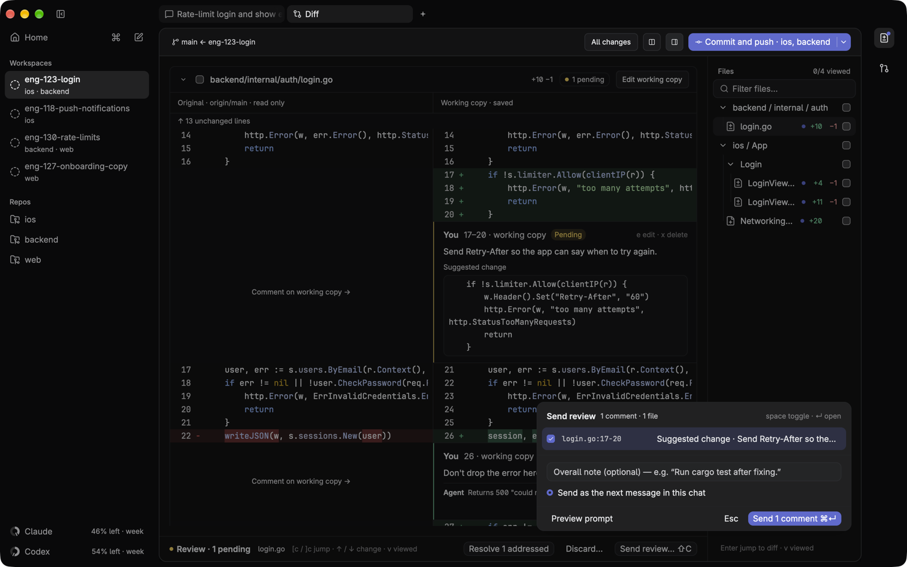
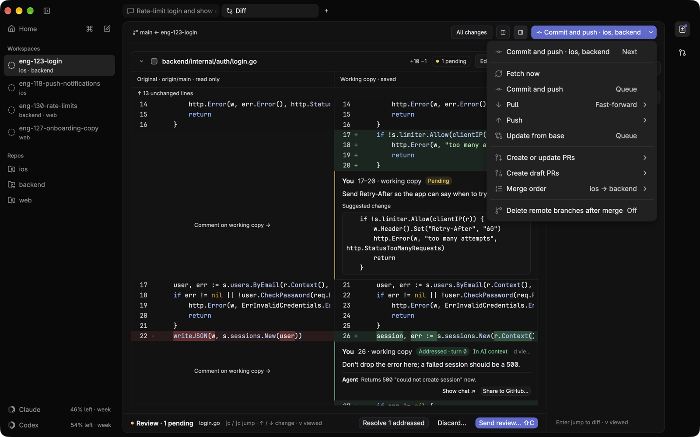
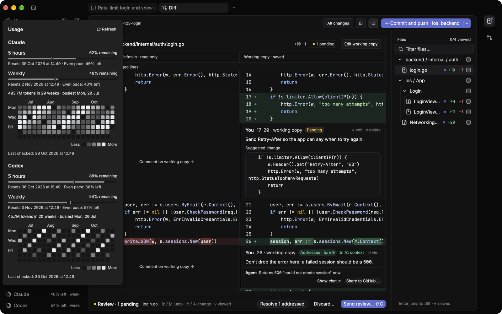

<h1 align="center">Shark</h1>

<p align="center">A fast, native macOS app for running coding agents on tasks that span several repos.</p>

<p align="center">
  <a href="https://github.com/KaffeDiem/shark/releases/latest"></a>
  
  <a href="LICENSE"></a>
</p>

<p align="center">
  <a href="#install">Install</a> · <a href="#quick-start">Quick start</a> · <a href="docs/manual.md">Manual</a> · <a href="https://github.com/KaffeDiem/shark/releases">Releases</a>
</p>


## Why Shark
<table>
<tr><td width="50%" valign="top"><b>Multi-repo workspaces</b><br>One task gets one git worktree per repo on a shared branch, and a single agent works across all of them.<br><br></td><td width="50%" valign="top"><b>Review the diff like a PR</b><br>Comment on lines across every repo, send the comments to the agent as one review, and track each until it is addressed.<br><br></td></tr>
<tr><td width="50%" valign="top"><b>Version-controlled plans</b><br>In plan mode each plan revision is saved and diffed against the last one. Press <code>a</code> to approve and build.<br><br></td><td width="50%" valign="top"><b>One git button</b><br>It shows the next step for every repo: commit, push, fix checks, address review, merge.<br><br></td></tr>
<tr><td width="50%" valign="top"><b>Stacked PRs</b><br>Start from another branch or PR. When the parent merges, Shark retargets the PR and rebases.<br><br></td><td width="50%" valign="top"><b>Claude and Codex</b><br>Model and thinking level per chat, with usage rings for what is left of your plan.<br><br></td></tr>
<tr><td colspan="2" valign="top"><b>Native and keyboard-first</b><br>GPUI on Metal, not Electron. Everything is in <code>cmd-k</code>, with an optional Vim mode.<br><br></td></tr>
</table>

## Azure DevOps
Repos whose `origin` is on Azure DevOps (`dev.azure.com`, `*.visualstudio.com` or `ssh.dev.azure.com`) work like GitHub ones, through the `az` CLI with its `azure-devops` extension instead of `gh`. Nothing to configure: the org, project and repo come from the remote. The git button reads each PR's status, build and status policies (as checks), reviewer votes (−5 or −10 asks for changes) and active comment threads, and can create, reopen, publish a draft, retarget and complete PRs. Completing uses squash unless the branch's merge-strategy policy rules it out, and only at the commit Shark checked. New PRs link the work items named in the branch (`feature/131035-x`). `#` completion, PR review checkouts, Share to PR from the diff, and the Git artifact's description, comments, replies and resolve all work too.

The Git artifact also lists **Work items**: the PBIs linked to the PR (or named in the branch when there is no PR yet), each with its tasks, their state, who they are assigned to, and how many are done. The workspace `CLAUDE.md` tells the agent which `az` commands replace `gh` for those repos.

Setup: `brew install azure-cli`, `az extension add --name azure-devops`, `az login`. Home shows what is missing once `az` is installed.

## Install
```sh
brew tap KaffeDiem/shark https://github.com/KaffeDiem/shark
brew install --cask KaffeDiem/shark/shark
```
Or [Download Shark 0.1.17](https://github.com/KaffeDiem/shark/releases/download/v0.1.17/Shark-0.1.17.dmg) (Apple Silicon), open it and drag Shark to Applications. The app isn't notarized: on first launch, open it, then allow it in System Settings → Privacy & Security → Open Anyway, or run `xattr -dr com.apple.quarantine /Applications/Shark.app`.

Needs `git`, `gh` (logged in) and `claude` on your login shell's PATH. For Codex models, also `codex` (logged in with `codex login`).

## Quick start
Shark opens on Home (`cmd-0`). Type what you want to build and press `enter` to start a workspace, or `tab` to ask Shark how to do something.

1. Choose **Add repo** in `cmd-k`. `cmd-n`, tick the repos, and name the branch. `enter` creates the workspace.
2. `shift-tab` for plan mode. Revise the plan in the chat, then `a` in the plan pane to build.
3. `cmd-shift-d`, or **Differ** in the Features rail, opens the Diff artifact with its changed-files tree. `c` on a diff line leaves a comment, and `shift-c` sends the review to the agent.
4. Create or update PRs (`cmd-k` or the git menu) opens linked PRs. The git button (top right) takes it from there.

## Learn more
- [Manual](docs/manual.md): every key, and how workspaces, git, stacks, plans and the agent work
- [Language intelligence](docs/language-intelligence.md) · [Git feature](docs/git-feature.md) · [Design](docs/design.md) · [Research](docs/research.md)

## Development
```sh
cargo run                                  # needs Xcode (Metal); Rust is pinned in rust-toolchain.toml
cargo test                                 # git/worktree, stream-json parser, PR linking
cargo test --features test-support         # + headless keyboard/mouse UI tests
cargo test --features test-support --test rendering # real GPU pixels: dark/light tab fades
cargo test --features test-support live_usage -- --ignored --test-threads=1 # live allowances + panel; no inference
cargo test live_claude -- --ignored        # real claude CLI round trip (costs a few cents)
cargo test live_codex -- --ignored         # the same through codex app-server
```

Releases: merge a PR with the `release` label. CI (which builds every merge to `master`) builds the DMG (`make release`), publishes a GitHub release, and commits the new version to `Cargo.toml`, `Casks/shark.rb` and the Install section above. The version is the one in `Cargo.toml`, or its next patch if that is already released.

## License
GPL-3.0 with an attribution term: copies and derived works must keep the copyright notice and credit "Shark by Kasper Munch Jensen". See [LICENSE](LICENSE).
