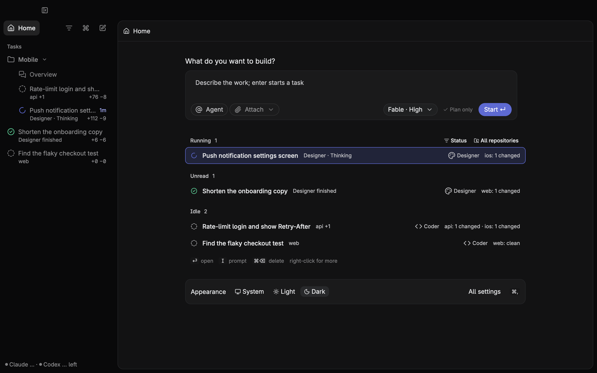
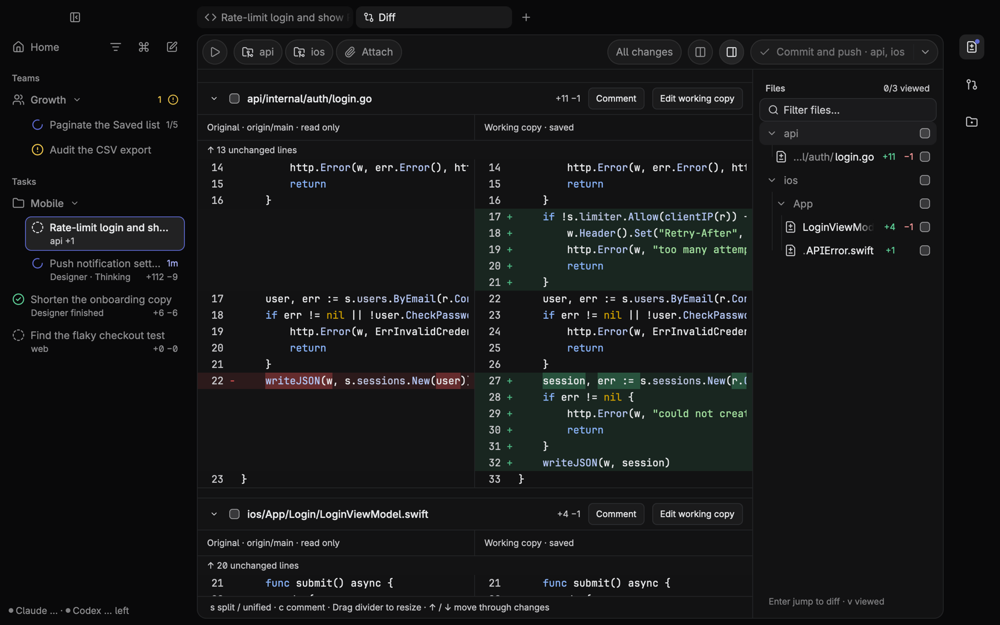
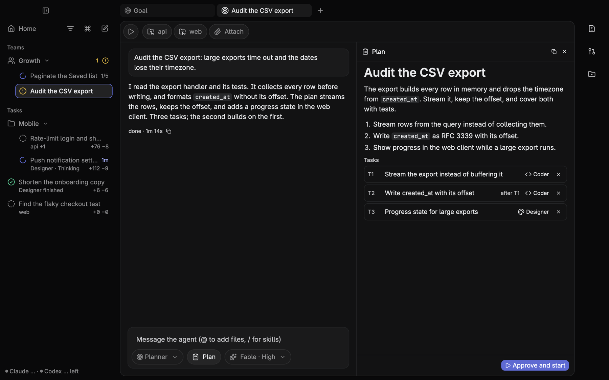
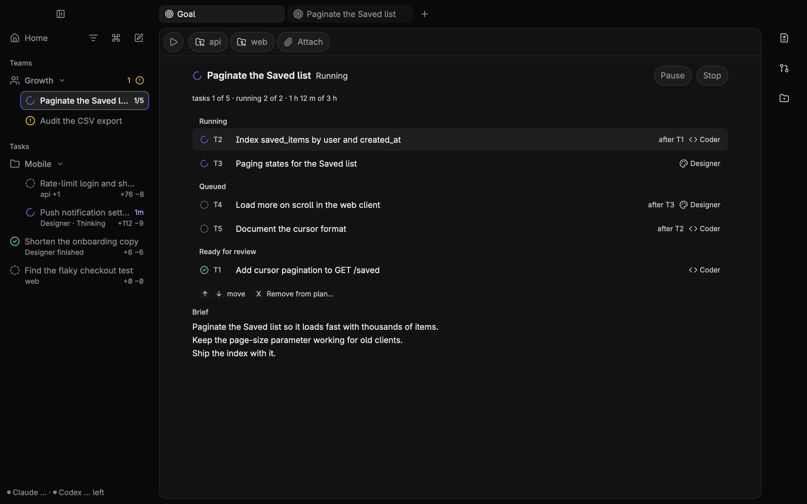
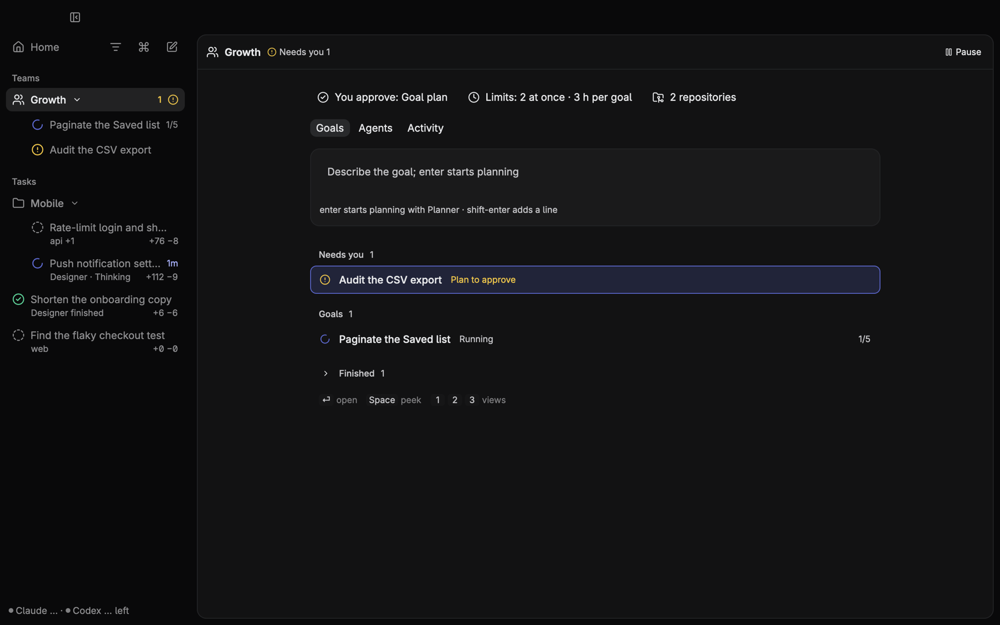

<h1 align="center">Shark</h1>

<p align="center">A native macOS app for getting real work out of coding agents: every task on its own branch, every change reviewed before it ships, and teams of agents that work through a plan you approved.</p>

<p align="center">
  <a href="https://github.com/KaffeDiem/shark/releases/latest"></a>
  
  <a href="LICENSE"></a>
</p>

<p align="center">
  <a href="#why-shark">Why</a> · <a href="#what-you-get">What you get</a> · <a href="#install">Install</a> · <a href="#quick-start">Quick start</a> · <a href="docs/manual.md">Manual</a>
</p>

<p align="center">
  
</p>

## Why Shark

Claude Code and Codex can write the code. What takes your time is everything around them: keeping five tasks apart, knowing which one waits for you, reading what actually changed, and getting it merged. Shark is built for that part.

- **Tasks don't collide.** Each task has its own branch and git worktrees, across one repository or several, with its own chats, plans and review state. Start a second task while the first one runs.
- **You know what needs you.** Home, the sidebar and the Dock badge show which task has a question, a plan to approve or a finished turn. `cmd-j` opens the next one.
- **Nothing ships unread.** You read the diff, comment on lines, send the review back to the agent, and edit the file yourself when that is quicker. Pushing, PRs and merging happen when you say so.
- **It runs on what you already have.** Shark drives the `claude` and `codex` CLIs with your existing sign-in and shows how much of your plan is left. It has no account and no server of its own.
- **It is a Mac app.** Written in Rust, not a web view. Every command is in `cmd-k`, and Vim keys are a setting.

## What you get

### Review and edit the diff

Differ shows one diff for every repository in the task, with the base on the left and your working copy on the right. Comment on a line or a range and send the comments to a chat as one review; the agent's answer is attached to each comment. **Edit working copy** lets you fix a line in place. Mark files viewed as you go.

<p align="center">
  
</p>

### Plans before code

In plan mode an agent reads and plans, and edits nothing until you approve. Each revision is a version with its changes marked, so you can see what your last reply changed. Approve it to build, or build it in a fresh chat that gets only the plan.

### Teams that work through a plan

A team is a lead agent and other agents, with repositories and limits. Give it a goal. The lead reads the code and writes a plan as a list of tasks, each with an agent and the tasks it comes after. You can reassign or remove tasks, then approve.

<p align="center">
  
</p>

Shark then starts each task on its own branch, in the background, and commits finished work locally. A task that comes after another starts from its branch, so the PRs stack. You are told when something needs you: a question, a stuck task, a limit reached. Nothing is pushed or merged without you.

<p align="center">
  
</p>

Limits use what can be measured on a subscription: tasks running at once, how much of your plan allowance must be left, agent time per goal and tasks per goal. Work stops when Shark quits and never resumes on its own.

<p align="center">
  
</p>

### From branch to merge

The Git button always offers the next step: commit and push, create linked PRs across the task's repositories, update from base, fix failing checks, address review comments, merge. Stack a task on another and its PR targets the parent; when the parent merges, the tasks on top are moved onto its base.

### The rest

- **Agents** are presets for a chat: name, icon, instructions, skills and default model. Pick one per chat, the way you pick a model, and hand a chat to the next agent with the transcript attached.
- **Artifacts** lists the plans and files agents write in the task's `.context` folder, with previews.
- **A file editor** with language servers, for the edits you would rather make yourself.
- **Linear** issues attach to a task and give it its branch name and context.
- **Open a PR from GitHub** in Shark with the [Chrome extension](extensions/chrome).

| Concept | What it is |
|---|---|
| **Task** | One piece of work, with separate branches, worktrees, conversations and review state. |
| **Agent** | A preset for a chat. A task has no agent; its chats do, and each chat can have a different one. |
| **Team** | A lead agent plus other agents, with repositories and limits. It works on goals. |
| **Goal** | What you ask a team for: a brief, a plan you approve, its tasks and a closing summary. |
| **Section** | Optional grouping of tasks in the sidebar and on Home. |

You start each task and decide what ships. Shark does not schedule work. A team starts the tasks of a plan you approved.

## Install

```sh
brew tap KaffeDiem/shark https://github.com/KaffeDiem/shark
brew install --cask KaffeDiem/shark/shark
```

Or [Download Shark 0.1.44](https://github.com/KaffeDiem/shark/releases/download/v0.1.44/Shark-0.1.44.dmg) for Apple Silicon and drag it to Applications. The app isn't notarized: after first launch, allow it in System Settings → Privacy & Security → Open Anyway.

Needs `git`, signed-in `gh` and `claude` on your login shell's PATH. For Codex models, also install `codex` and run `codex login`.

## Quick start

1. **Add a repository.** Use **Add repo** in `cmd-k`. Optionally choose **New agent…** there and set its instructions and default repositories.
2. **Start a task.** Describe the work on Home (`cmd-0`) and press Enter. Pick an agent for its first chat with **@ Agent**, or type `@designer fix onboarding spacing`. Attach repositories as needed.
3. **Guide the work.** Use `shift-tab` for plan mode. Review the plan and approve it when ready; a task needs a repository before building. Plans and files agents produce are in **Artifacts** (`cmd-shift-a`).
4. **Review and ship.** Open **Differ** (`cmd-shift-d`) to inspect changes and send comments back to a chat. Use **Git** (`cmd-shift-g`) for PR discussions and the git menu to create, update and merge PRs.
5. **Finish the task.** Delete it when done; this removes its conversations, plans and worktrees. Agents stay available for the next chat.
6. **Try a team.** Choose **New team…** in `cmd-k`, pick a lead, one or more agents and the repositories, then describe a goal on the team's page. Approve the plan and review the tasks as they finish.

For existing branches or PRs, use **New task from branch or PR…** in `cmd-k`, or the [Chrome extension](extensions/chrome) on a GitHub PR page. A selected agent carries through to its first chat. Every command and its shortcut is discoverable in `cmd-k`.

## Documentation

- [Manual](docs/manual.md): daily workflow, skills, shortcuts and recovery.
- [Design](docs/design.md): product boundaries, UI rules and components.
- [Language intelligence](docs/language-intelligence.md) and [Git feature](docs/git-feature.md): focused references.
- [Research](docs/research.md): dated background, not the current product specification.

## Development

Requires Xcode for Metal; Rust is pinned in `rust-toolchain.toml`.

```sh
cargo run
cargo test -- --test-threads=1
cargo test --features test-support -- --test-threads=1
```

Tests run serially because some change process environment variables. The opt-in `--features test-support --test rendering` target checks real GPU output. The screenshots above come from it: `SHARK_RENDER_README=1 SHARK_RENDER_DIR=docs/images cargo test --features test-support --test rendering` rewrites `docs/images/readme-*.png` from demo data. Ignored `live_claude` and `live_codex` tests call real models and incur usage; `live_usage` checks signed-in allowances without inference.

To release, merge a PR labeled `release`. CI builds the DMG and updates the version in Cargo, the Homebrew cask and this README. See [release workflow](.github/workflows/release.yml).

System notifications open the finished chat when clicked. They need the bundled `Shark.app` and notification permission; `cargo run` builds skip them.

## License

GPL-3.0 with attribution: copies and derived works must credit “Shark by Kasper Munch Jensen”. See [LICENSE](LICENSE).
