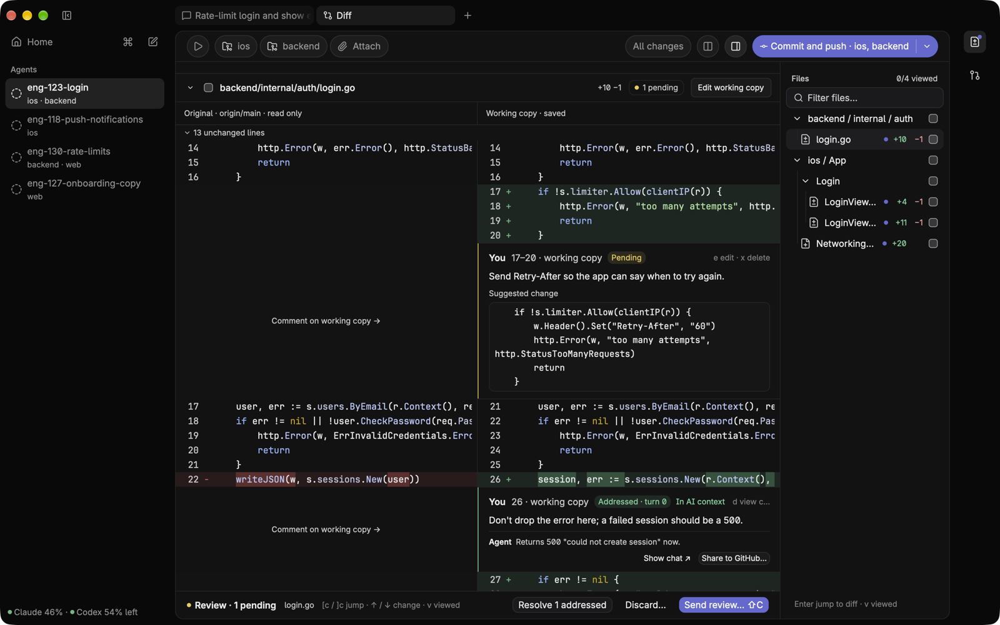
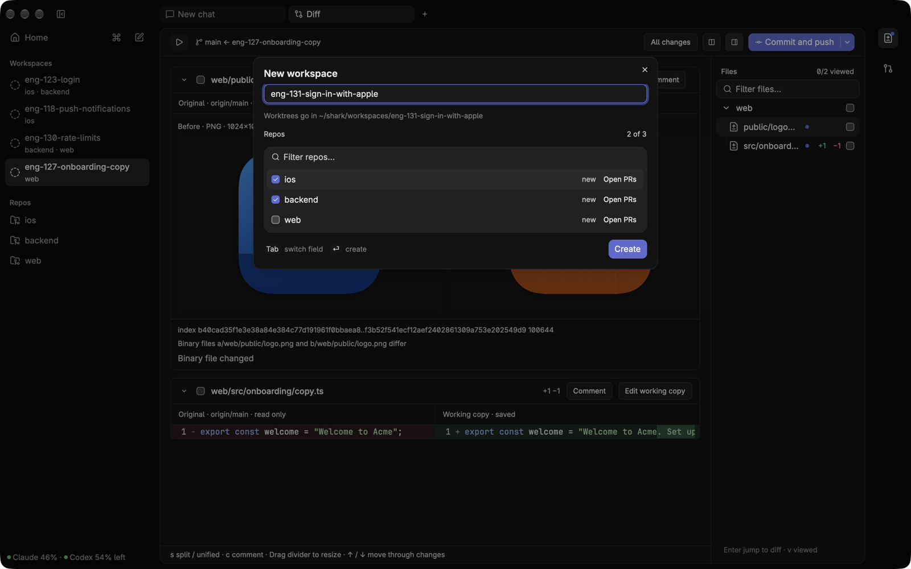
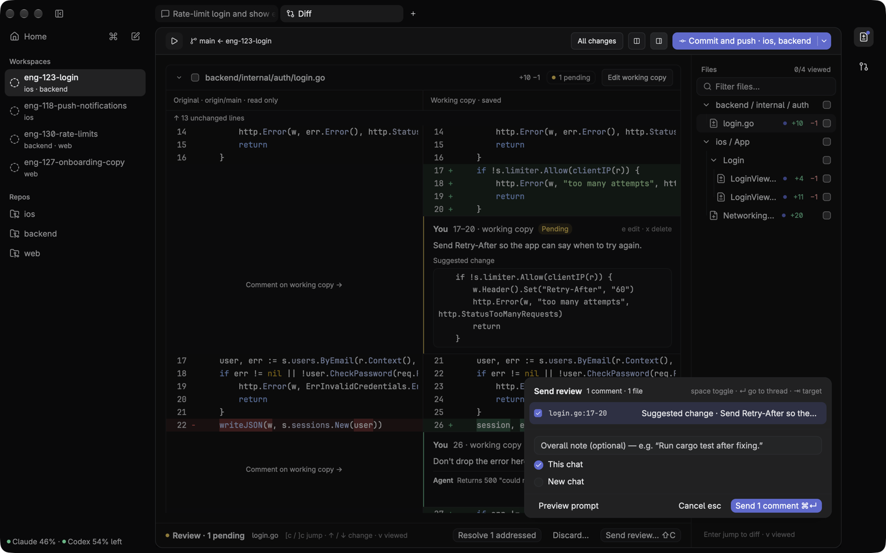
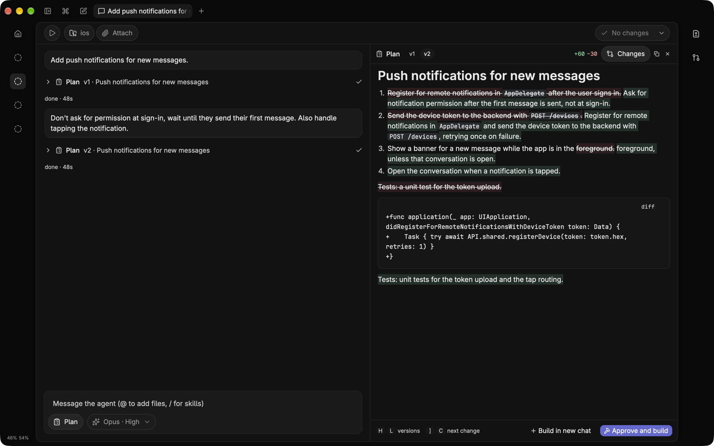
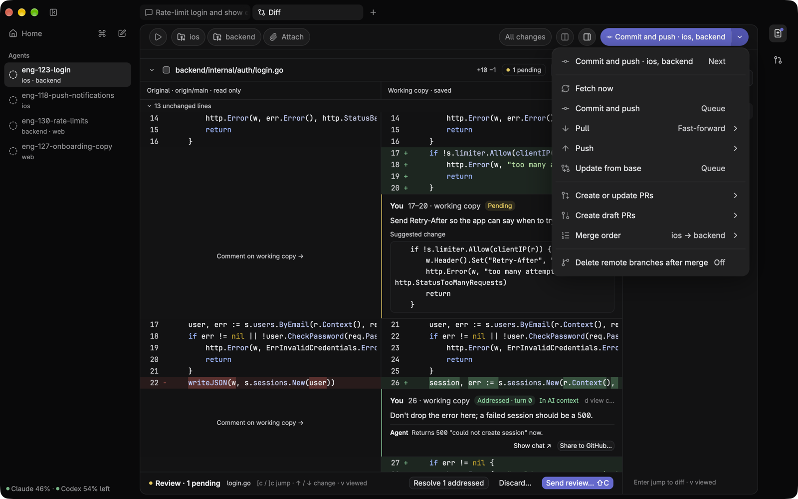
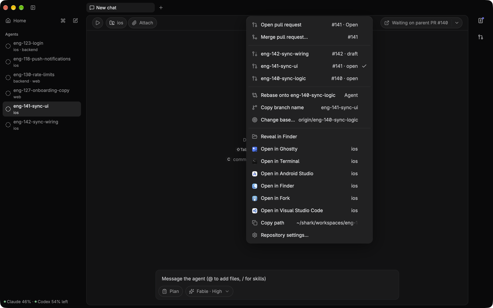
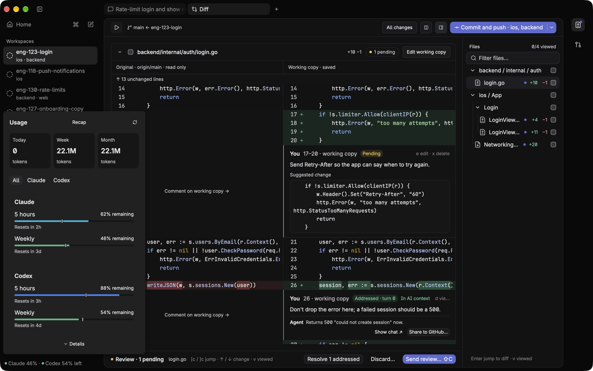
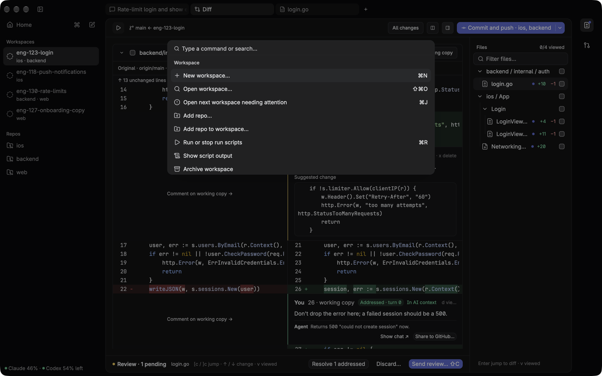

<h1 align="center">Shark</h1>

<p align="center">A fast, native macOS app for running coding agents on tasks that span several repos.</p>

<p align="center">
  <a href="https://github.com/KaffeDiem/shark/releases/latest"></a>
  
  <a href="LICENSE"></a>
</p>

<p align="center">
  <a href="#install">Install</a> · <a href="#quick-start">Quick start</a> · <a href="docs/manual.md">Manual</a> · <a href="https://github.com/KaffeDiem/shark/releases">Releases</a>
</p>



## Why Shark
<table>
<tr><td width="50%" valign="top"><b>Multi-repo agents</b><br>One task gets one git worktree per repo on a shared branch, and its chats work across all of them.<br><br></td><td width="50%" valign="top"><b>Review the diff like a PR</b><br>Comment on lines across every repo, send the comments to the agent as one review, and track each until it is addressed.<br><br></td></tr>
<tr><td width="50%" valign="top"><b>Version-controlled plans</b><br>In plan mode each plan revision is saved and diffed against the last one. Press <code>a</code> to approve and build.<br><br></td><td width="50%" valign="top"><b>One git button</b><br>It shows the next step for every repo: commit, push, fix checks, address review, merge.<br><br></td></tr>
<tr><td width="50%" valign="top"><b>Stacked PRs</b><br>Start from another branch or PR. When the parent merges, Shark retargets the PR and rebases.<br><br></td><td width="50%" valign="top"><b>Claude and Codex</b><br>Model and thinking level per chat, with the quota left on your plan and when it resets.<br><br></td></tr>
<tr><td colspan="2" valign="top"><b>Native and keyboard-first</b><br>GPUI on Metal, not Electron. Everything is in <code>cmd-k</code>, with an optional Vim mode.<br><br></td></tr>
</table>

## Install
```sh
brew tap KaffeDiem/shark https://github.com/KaffeDiem/shark
brew install --cask KaffeDiem/shark/shark
```
Or [Download Shark 0.1.28](https://github.com/KaffeDiem/shark/releases/download/v0.1.28/Shark-0.1.28.dmg) (Apple Silicon), open it and drag Shark to Applications. The app isn't notarized: on first launch, open it, then allow it in System Settings → Privacy & Security → Open Anyway, or run `xattr -dr com.apple.quarantine /Applications/Shark.app`.

Needs `git`, `gh` (logged in) and `claude` on your login shell's PATH. For Codex models, also `codex` (logged in with `codex login`).

## Quick start
An agent is a durable unit of work: its conversations, attached repositories, changes and review state.

Shark opens on Home (`cmd-0`). Type what you want to build and press `enter` to start an agent at once, with no dialog and no repository needed (the title comes from the first line), or `tab` to ask Shark how to do something.

1. Choose **Add repo** in `cmd-k`. `cmd-n` opens a new agent with an empty conversation; **Attach repository** (button, or `cmd-k`) gives it a repo. For a branch or PR checkout, or a stack, choose **New agent from branch or PR…** in `cmd-k`, tick the repos, and name the branch. `enter` creates the agent.
2. `shift-tab` for plan mode. Revise the plan in the chat, then `a` in the plan pane to build. An agent with no repository stays in plan mode, and building needs a repository.
3. `cmd-shift-d`, or **Differ** in the Features rail, opens the Diff artifact with its changed-files tree. `c` on a diff line leaves a comment (`cmd-shift-enter` sends it right away), and `shift-c` sends the review to this chat, a new chat on a model you pick, or another open chat.
4. Create or update PRs (`cmd-k` or the git menu) opens linked PRs. The git button (top right) takes it from there.
5. **Rename agent…** in `cmd-k` changes only the title. **Delete agent** (`cmd-backspace`) removes its conversations, plans, attachments and worktrees.

## Learn more
- [Manual](docs/manual.md): every key, and how agents, git, stacks and plans work
- [Language intelligence](docs/language-intelligence.md) · [Git feature](docs/git-feature.md) · [Design](docs/design.md) · [Research](docs/research.md)

## Development
```sh
cargo run                                  # needs Xcode (Metal); Rust is pinned in rust-toolchain.toml
cargo test                                 # git/worktree, stream-json parser, PR linking
cargo test --features test-support         # + headless keyboard/mouse UI tests
cargo test --features test-support --test rendering # real GPU pixels: dark/light tab fades
cargo test --features test-support live_usage -- --ignored --test-threads=1 # live allowances + panel; no inference
cargo test live_claude -- --ignored        # real claude CLI round trip (costs a few cents)
cargo test live_codex -- --ignored         # the same through codex app-server
```

Releases: merge a PR with the `release` label. CI (which builds every merge to `master`) builds the DMG (`make release`), publishes a GitHub release, and commits the new version to `Cargo.toml`, `Casks/shark.rb` and the Install section above. The version is the one in `Cargo.toml`, or its next patch if that is already released.

## License
GPL-3.0 with an attribution term: copies and derived works must keep the copyright notice and credit "Shark by Kasper Munch Jensen". See [LICENSE](LICENSE).
