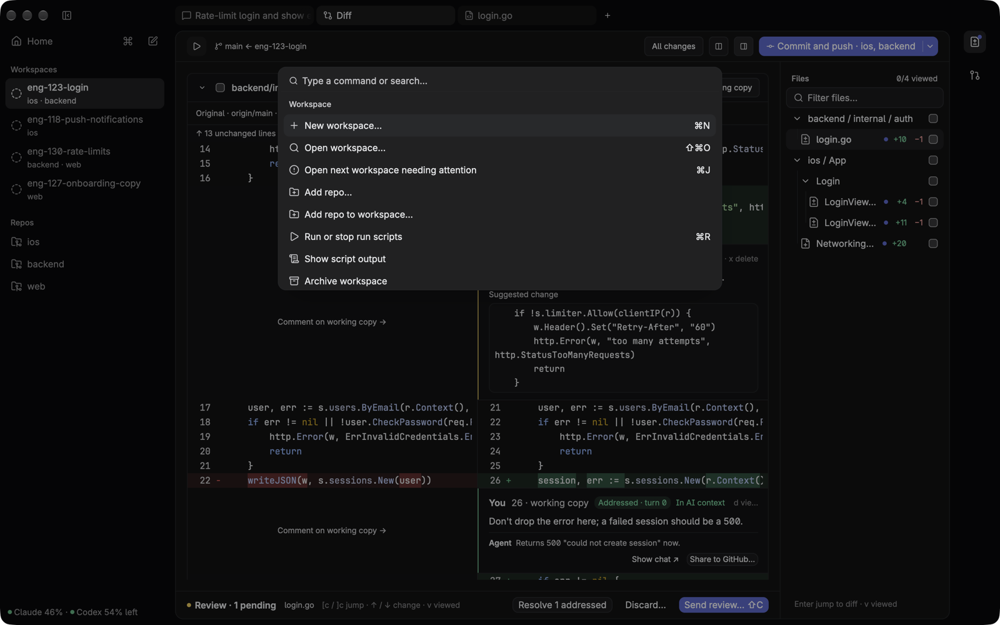
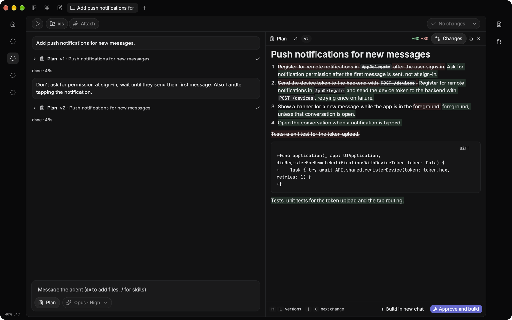
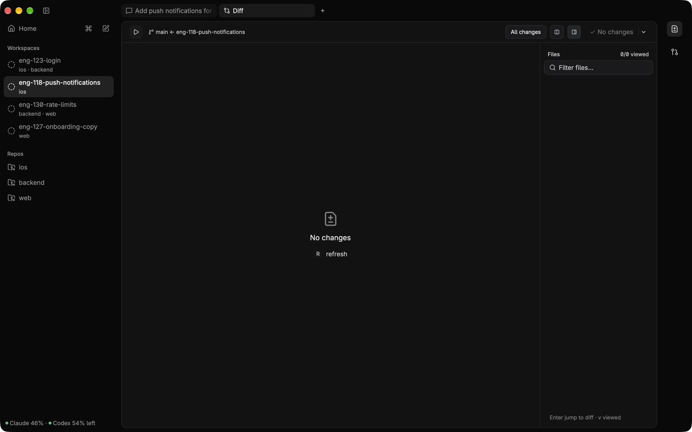
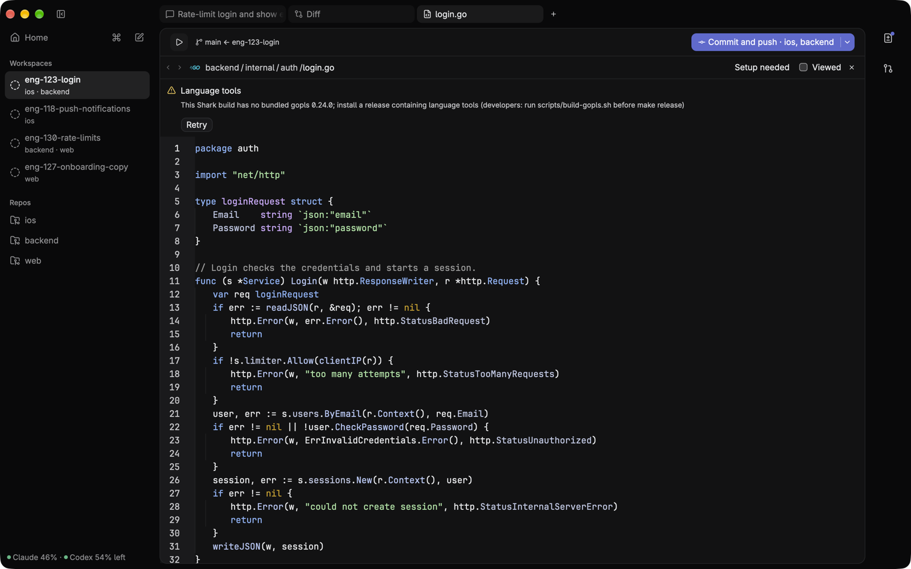
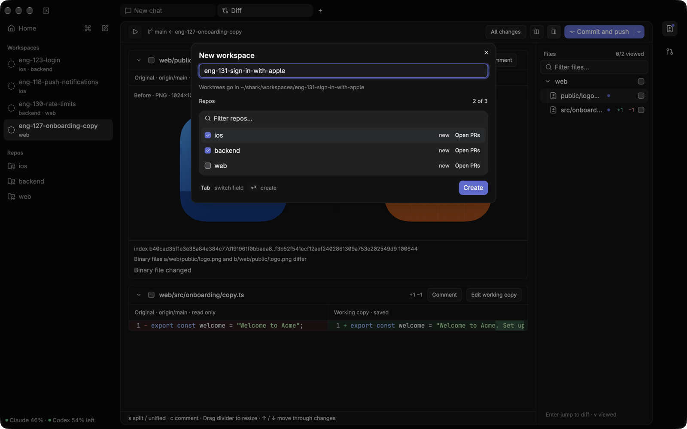
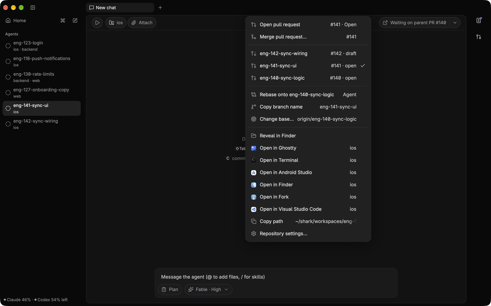

# Shark manual

The full reference for [Shark](../README.md): every feature, every key, and how it works underneath.

An **agent** is a named set of instructions, skills and defaults that stays between tasks. A **task** is one isolated piece of work: its conversations, attached repositories, worktrees, changes and review state. A **harness** runs Claude or Codex for a chat.

## Fast and native
Shark is built on [GPUI](https://www.gpui.rs), Zed's GPU-rendered UI framework, running on Metal. It is not an Electron app. Everything is in the `cmd-k` palette, which shows each command's shortcut, and an optional Vim mode adds Vim keys to the editor, the composer and every list. The UI stays responsive while agents work. Chat history loads off the UI thread, git status runs with `--no-optional-locks` so it never takes the task's `index.lock`, and `ctrl-c` interrupts a turn while the claude process stays warm.

## Account usage
The navigation footer shows the Claude and Codex quota left on one line. A colored dot beside each percentage compares what is left with an even burn through the window: green when you are on or ahead of it, amber when you are behind it, red when well behind or nearly out. Unknown or outdated values show a dash and a neutral dot; hover for full quota and status details. Click it to open **Usage**, or use **Show usage** in `cmd-k`. The panel lists each quota with the percentage left, a bar with a tick at the even pace, and the reset time in your local timezone. Shark checks at startup and every five minutes while its window is active, including when the panel is closed. Returning to Shark refreshes overdue data; opening the panel and Refresh also fetch immediately. Queries use your signed-in CLIs without sending a prompt, and results stay in memory. Outdated results are muted. Claude’s experimental usage contract may become unavailable after a CLI update.

## Version-controlled plans
In plan mode (`shift-tab`) the agent, Claude or Codex, reads and plans but edits nothing. Each plan it proposes is saved as a new version. The plan pane shows what changed since the previous version: added words in green, removed words struck through in red, changed code blocks as diffs. Reply in the chat to revise the plan, step through versions with `h`/`l`, and press `a` to approve and build. A task with no repository stays in plan mode: building needs a repository, so attach one first.

## Features and artifacts
A **feature** is a capability that opens an **artifact** in a task tab. An artifact is the view you work in: an AI chat, a diff viewer, or a file editor. Each artifact keeps its own controls together.

The fixed **Features** rail on the right contains **Differ** and **Git**. Git opens a PR view for reviewing and editing descriptions, reading comments, replying to review threads, and resolving or reopening them. Select Differ to open the task's Diff artifact, or focus that tab if it is already open. Its changed-files tree lives inside the artifact; switching to a chat or file hides the tree with the diff. New tasks still start with a chat.

## Review the diff like a PR
The diff shows the original and the working copy side by side, across every repo of the task, against the base or (Uncommitted only) against `HEAD`. Changed images show before and after, and videos play inline. Press `i` to edit the working copy in place, or `c` to comment on a line, with an optional suggested change. `cmd-shift-enter` in the comment sends it to the chat at once; `cmd-enter` keeps it pending and `shift-c` sends the comments you tick as one review, to this chat, a new chat on a model and thinking level you pick, or another open chat. Each one is then tracked as sent, addressed or outdated. A comment can also go to the open GitHub PR as a note or a Comment review.

## Full-width file tabs
Open a file from the Diff artifact's tree or `cmd-p` to edit it across the central area. Chat and Diff stay one tab away, and Command-click keeps additional files open. A small dot in the file tree marks uncommitted changes; right-click a file and choose **Discard uncommitted changes…** to restore its last commit after confirmation. New files are deleted when discarded.

Drag chat, Diff, and file tabs into any order. Tabs stay inside the strip and move horizontally. Neighboring items animate into place while you drag. Dropping inside saves the order; releasing outside cancels. Each task remembers its order and reopens file tabs in the background when you return or restart. Unsaved edits still require saving or discarding before you leave; restored files use their contents on disk. Files that cannot be reopened are reported together and retried on the next visit. Drag empty header space to move the window; tab drags only reorder tabs.

See [Language intelligence](language-intelligence.md) for supported languages, tool setup, navigation shortcuts, and limitations.

## Multi-repo tasks
One task = one git worktree per repo on a shared branch, e.g. `~/shark/workspaces/eng-123-login/{ios,backend}`. Its chats work across all of them. A task can also start with no repository and attach them later. The diff is combined, PRs are cross-linked and merge in an order you set, and one git button shows the next step for every repo: commit, push, fix checks, address review, merge.

## Stacked PRs
A task can start from another branch or an open PR instead of `main` (**New task from branch or PR…** in `cmd-k`): its PR then targets that branch. For example, a backend change and an iOS feature in three PRs: logic, UI on top of logic, wiring on top of UI. Each repository chip in the header shows its repository, and its checked-out branch when that isn't the attached one. Hover it for the branch, base and stack position (`2 of 3`), or click it for the same details in its menu; its menu lets you jump to the task or PR above or below, or rebase that repository onto its parent. **New task on top…** and **Insert task below…** remain in the task menu and `cmd-k`. Each repo of a task has its own stack, so the iOS repo can be stacked while the backend repo targets `main`. When a parent PR merges, the git button moves the PR onto the parent's base, and the agent rebases only the branch's own commits, also after a squash merge.

## Home
Shark opens on Home (`cmd-0`) when no task is open. It shows what's missing (git, gh, claude), every task grouped by what it needs from you (Needs you, Running, Unread, Idle), and a Get started checklist (one line once you have tasks; Hide Get started in `cmd-k` removes it). Choose an agent in the visible picker, or **Repository defaults** for a task without an agent. Type what you want to build and press `enter` to start a task with that as its first message; the title comes from its first line. Press `tab` to ask Shark how to do something (a one-off Haiku answer from the README, this manual and the live keymap). **All tasks** in the sidebar shows every task, grouped by status or optional task groups. `esc` returns from an overview to the active task, or to Home when no task is active.

## Agents
Create an agent from the sidebar with a name, icon, instructions, default repositories, model and thinking level. Its page has Tasks, History and Instructions & skills tabs. **Edit agent** opens its editing dialog directly. **New task** opens Home with that agent selected. On Home, use the agent picker or type `@designer fix the onboarding spacing` to start a task. **New task for agent…** in `cmd-k` opens the same prompt. Unknown `@names` stay ordinary text; Ask Shark mode does not start agent tasks.

Each task gets its own branches and worktrees. Several tasks can run for the same agent, including in the same repository. Their chats receive a note naming the other open tasks and their changed files, refreshed when a turn ends. The note lists at most 20 files per task and asks the model to avoid editing them. It is guidance, not a file lock.

Instructions reach Claude through `CLAUDE.md` and Codex through `AGENTS.md`. Closing the agent settings dialog updates every open task; existing chats receive changed instructions with their next message. New chats use the agent's model and thinking defaults before repository defaults.

**Open skills folder** creates `~/Library/Application Support/shark/agents/<slug>/skills`. Put each skill in `<skill>/SKILL.md`, then choose **Refresh skills** on the agent’s **Instructions & skills** tab, or close its editing dialog, to refresh task links. Shark links these skills into both `.agents/skills` and `.claude/skills` in each task. The **Skills from repos** setting controls repository skills only. Agent skills remain enabled. If a harness does not discover a newly added skill during a session, start a new conversation.

The agent page lists its open tasks and the latest 100 deleted tasks, including known PR links and merge status. **PR state unknown** means Shark had no successful status to record. Finish or delete all open tasks before deleting the agent; deleting the agent also deletes its instructions, history and skills folder. Task groups are independent of agent identity: moving a task into a group never changes its agent or instructions.

## Linear
Linear stays out of the way until someone uses it. Until you connect, and unless a task has an issue attached, the header's **Attach** goes straight to the repository dialog, and Home, `cmd-k` and **Delete task** don't mention Linear. Settings › Linear is always there, and this is the way in.

Settings › Linear connects one Linear workspace, read-only, and shows the connection in one row. **Sign in with Linear** opens your browser; it needs port 48173 free and isn't available until Shark's Linear app is registered, which the row says. While Shark waits for your browser you can **Cancel**, which isn't treated as a failure. A notification says when you're connected, even if you've closed Settings by then. **Use API key** takes a personal key; create it with Read access, since Shark only reads. **Open Linear's API key page** goes straight to Settings > Account > Security & Access in Linear. A key Linear doesn't accept stays in the field with the error under it, so you can correct it. It's held in memory only and is cleared once a key connects.

Shark checks a new credential with Linear and saves it to the Keychain before it replaces a working connection, so a bad key or a Keychain failure changes nothing. If the credential belongs to a different workspace, Shark asks first: attached issues stay readable but can't refresh, and nothing changes in Linear. `state.json` keeps only the workspace, the user and the method. Shark doesn't read the Keychain until a Linear feature needs the credential.

If Keychain access isn't granted or Linear rejects the credential, the row shows a warning with the reason. **Reconnect** repeats how you connected: the browser for sign-in, the key field for an API key or while sign-in isn't available. To change method, disconnect first. After a declined Keychain prompt, **Try again** asks again.

**Disconnect** asks first, then deletes the credential from the Keychain and the connection from settings. It changes nothing in Linear. If the delete fails, Shark says so and stays connected. Attached issues stay readable but can't refresh.

**Attach** › **Linear issue…** in the task's header, or **Attach Linear issue…** in `cmd-k`, opens on **Assigned to me** and **Recent**. Each row shows the issue's state, identifier, title, status name, priority, assignee and age. Typing narrows the loaded rows at once, and after a short pause with two characters or more a search replaces them, 20 at a time, with **Load more** as the last row. Results are kept while the picker is open, so asking again sends nothing. A pasted URL or an identifier such as `ENG-123` finds that issue, and `Look up ENG-123` is ready before the search answers; a term shaped like an identifier, such as `gpt-4`, is searched as well. If a request fails, your query and the rows stay, with **Retry**. If Linear rate limits you, Shark says when it will resume and does so with your latest query; closing the picker stops it. Searches stay under Linear's limit of 30 a minute by waiting when they would go over. Without a connection the picker says so in place of the rows, and `enter` opens Settings › Linear over it. A connection that needs attention gives its reason and **Reconnect** the same way. Once connected, Settings closes and the picker goes on with your query; closing Settings leaves the picker as it was.

`enter` attaches the highlighted issue. `cmd-enter` marks it and keeps the picker open, so you can gather several across searches; the footer counts them, and `enter` or **Attach** attaches exactly those, not the highlighted row. Attached issues show a check and aren't attached again. Attaching works while a turn runs or a repository attachment waits, and it only adds reference material: it starts no turn and leaves the title alone. The first issue attached is primary, and its chip has a star. Chips show the issue's identifier and a gray icon for its state. If any of them are disconnected, one **Disconnected** mark beside them says so and opens Settings › Linear; each chip's hover card and the issue's details say it for that issue.

Click a chip, or use **Show Linear issue…** in `cmd-k`, to read the issue. Shark keeps a snapshot of its title, description, status, team, project and assignee, and shows how long ago it was synced. From there:
- **Open in Linear**.
- **Refresh**. Only this updates a snapshot, and it shows its progress in place. If it fails, the old snapshot stays. A missing snapshot comes back this way.
- **Make primary**. The primary names new branches and comes first in context: a first repository's branch starts from its identifier, such as `eng-123-marlin`. An issue only names the branch before the first repository: once the task has a repository, attaching an issue or changing the primary leaves the branch as it is. Changing the primary never renames a branch or changes a title.
- **Remove attachment**. The earliest remaining issue becomes primary if this was the primary. Later turns leave the issue out, and the conversation keeps what it was told.

A snapshot from another organization than the connected one, or with no connection, stays readable and shows as disconnected. Refresh says why it can't run.

Every chat gets an issue's text with its next normal message, and again only when a Refresh finds the issue changed. A Refresh that finds nothing new, or changing the primary, sends nothing. Slash commands and messages sent mid-turn go out as written, and the update waits. The text is marked as external task material, not instructions or permission to attach repositories, and what a chat was told stays in its transcript as sent.

**Start from Linear issue**, on Home or in `cmd-k`, finds an issue the same way, then previews it with an editable title and planning request, and says the task starts in Plan mode with no repository yet. Nothing exists until you accept. The task then starts like any other, with the issue attached before its first turn.

Snapshots live in `~/Library/Application Support/shark/linear/<task>.json`. Deleting a task removes its file once the task is gone; a refused delete leaves it. Shark only reads from Linear.

## Requirements
Needs `git`, `gh` (logged in) and `claude` on your login shell's PATH. For Codex models (GPT-6.1 Sol, GPT-6 Astra), also `codex`, logged in with `codex login` (a ChatGPT plan works). Codex chats have no side questions. They have a **Fast** toggle for Codex's faster service tier, which uses more of your plan's usage.

## Keys
| Where | Keys |
|---|---|
| anywhere | `cmd-k` palette · `cmd-,` settings · `cmd-0` Home (again, or `esc` on Home, goes back to the task) · `cmd-n` new task (agent page: prefilled Home; elsewhere: empty conversation) · `cmd-shift-o` open task (type a task or repo name; Enter opens the best match, or the most recent other task with no query; Escape closes) · `cmd-o` app switcher (hold `cmd`, tap `o` to cycle; `cmd-shift-o` reverses while open; release `cmd` to open; `esc` cancels) · `cmd-t` new chat · `cmd-w` close current tab · `cmd-shift-t` reopen closed chat · `ctrl-tab`/`ctrl-shift-tab` next/previous tab in the saved order · `cmd-shift-]`/`[` next/previous chat · `ctrl-1…9` open the Nth visible tab (hold `ctrl` to see the numbers) · `cmd-1…9` open the Nth task (hold `cmd` to see the numbers) · `cmd-j` next task that needs you · `cmd-p` open any file · `cmd-r` start/stop the task's run scripts (repo settings) · `ctrl-c` interrupt the shown chat's turn, again to stop the process (not in the editor) · `cmd-alt-←/→` previous/next pane (Vim: `ctrl-w h/l`) · `cmd-b` sidebar ↔ icon rail · `cmd-.` Zen mode on/off: only the shown chat, Diff, Git or file, without sidebar, tabs, header or Features rail; every shortcut still works (`cmd-b` or Home ends it) · `cmd-shift-d` show the diff · `cmd-shift-g` show Git · `ctrl-cmd-v` Vim mode on/off (also Settings › General) · `cmd-/` model and thinking menu (type a letter to jump, again to cycle) · `cmd-shift-f` fast mode on/off (Codex chats) · `cmd-shift-.`/`cmd-shift-,` thinking level up/down · `ctrl-cmd-1…6` Fable/Opus/Sonnet/Haiku, then GPT-6.1 Sol/GPT-6 Astra · `cmd-q` quit (while agents work it warns first, as Chrome does: hold `cmd-q`, or press it again within a second, and Shark quits when you let go; the menu's Quit doesn't ask) · `cmd-h` hide · `cmd-m` minimize |
| sidebar, transcript | `↑/↓` `home`/`end` `pageup/pagedown` · with Vim mode `j/k` `gg` `G` `ctrl-d/u`, and `g t`/`g T` next/previous chat · `enter` open / toggle tool output (`o` too in the transcript) · `y` copy the selected message, reply, tool output or plan · `i`/`a` → composer |
| task groups | **All tasks** → **Group by task group** · **Task groups…** creates or edits groups · Rename, Change icon and Delete group leave tasks and their agent instructions intact · **Move task to group…** changes grouping only |
| composer | `enter` send (queues while the agent runs) · `cmd-enter` send now, steering the running turn · `cmd-shift-enter` ask as a side question · `↑` on the first line → queue · `shift-enter` newline · `esc` → normal mode · `@` add a file or folder (`repo/` to pick the repo) · drop files from Finder anywhere on the chat (a dashed overlay shows while they hover), or `cmd-v` copied files or an image, to attach them · `/` skills and commands at the start · `#` a PR from any repo, sent as its URL (by number, title, author or branch; `enter` picks only an exact number or a word match, so `#endif` stays text) · in the menu `↑/↓` `enter`/`tab` `esc` · key hints under the composer show only while a turn runs |
| queue | `↑/↓` `home`/`end` (Vim: `j/k` `gg` `G`) · `enter` send now · `e` edit (`enter` puts it back) · `d`/`backspace` delete · `alt-↑/↓` move up/down (Vim: `shift-k/j`) · `esc`/`i`, or `↓` past the last row → composer |
| Home | `↑/↓` `home`/`end` (Vim: `j/k` `gg` `G`) · `enter` open the task · `cmd-backspace` delete it (also in the sidebar) · right-click it for more · `i`/`a` → the prompt · in the prompt `enter` starts a task with it as the first message (Ask Shark: ask), `tab` new task ↔ Ask Shark · `esc`/`ctrl-c` stop an answer |
| side question | `esc` dismiss · `c` copy the answer · `enter` put the answer into the composer |
| agent questions | `1`–`9` pick (tick in multiple choice) · `↑/↓` move · `space` tick · `enter` next / send on the last · `esc` from "Something else…" back to the choices, else answer in the chat instead · `↑` from the composer's first line back to the card |
| `cmd-k` | every command, with its shortcut on the right: tasks (New task from branch or PR…; with a task open or under the cursor also rename, delete, force delete, attach a repository, reveal in Finder, open in Terminal or any other installed app, copy path/branch), chats, plan, files and diff, git (next step, git menu, fetch, create/draft/merge/open PRs, merge order, stacks: branch menu, new task on top, insert below, rebase onto parent, go to stack), task groups, view (Go to Home, Hide Get started), settings · the Help menu has Keyboard shortcuts (this palette), the README and Report an issue · type to filter; extra words match too (`pr`, `github`, `discard`) |
| New task from branch or PR… | `enter` create (in branch) · `tab` branch ↔ repo filter · type to filter · `enter` tick match · `space` tick/untick highlighted · `cmd-b` branches · `cmd-p` open PRs · in those lists `enter` checks the branch out (reviews the PR) and `alt-enter` bases the new branch on it · `cmd-r` refresh sources · `cmd-enter` create · last-used repos start ticked |
| Attach repository | type to search · `enter` attach the marked repositories, or the highlighted one if none are marked · `cmd-enter` mark · `cmd-b` Change, again Base · `tab` take the suggested name; in Change, name ↔ branches · `esc` back, then close |
| sidebar mouse | **Home**, **All tasks** and each agent open their own page · **New agent** creates a reusable agent · task rows open their task; right-click for rename, move to task group, reveal, copy or delete · drag folders from Finder onto the sidebar to add them as repos |
| Settings › Repositories | click a repo: its settings (default model, setup/run/archive scripts) and New task · right-click a repo: New task from this repo…, attach to a task, reveal or open it · drag repos to set the order their scripts start in · **Add repo…** · also **Repository settings…** in `cmd-k`, or on a repository chip's menu |
| plan mode | `shift-tab` (composer, transcript, queue, plan) plan mode on/off (a task with no repository stays in plan mode) · Show or hide plan, Approve plan and build, Build plan in a new chat in `cmd-k` · in the pane `↑/↓` scroll (Vim: `j/k` `gg` `G` `ctrl-d/u`) · `←/→` (Vim: `h/l`) older/newer version · `alt-↓/↑` (Vim: `]c`/`[c`) next/previous change · `d` changes on/off · `a` approve · `n` build in a new chat · `i` → composer · `y` copy the shown version · `enter` on a transcript **Plan** row opens that version |
| settings | `ctrl-tab`/`ctrl-shift-tab` next/previous page (General, Appearance, Prompts, Repositories, Linear) |
| diff | `cmd-alt-b` changed-files tree on/off (only while Diff is active) · `↑/↓` `home`/`end` move the line cursor (kept across refreshes); with Vim mode `j/k` `gg` `G` `ctrl-d/u` move it, the arrows scroll and `h/l` scroll sideways · `alt-↓/↑` changes · `]c`/`[c` comment threads (changes when there are none) · `}`/`{` files · `v` viewed / `o` open the cursor's file · `s` split/unified · `r` refresh · `p` play/pause the file's video · viewed checkbox in each file header · `i` edit the working copy in place (`cmd-s` save, `esc` back to reviewing) · `c` comment on the cursor line or selected lines (`c` on a pending one edits it), `cmd-shift-s` in the comment adds a suggested change, `cmd-enter` adds it, `cmd-shift-enter` sends it to the chat now · on a thread: `e` edit, `x` delete, `d` view the change, `r` resolve, `shift-r` reopen · `shift-c` send review |
| Git | `↑/↓` move the item cursor · `enter` edit / reply / expand / read the cursor item · `e` edit the description · `r` reply to the cursor's thread · `c` comment · click the title or description to edit in place · `cmd-enter` or `cmd-s` save or post the open editor · `esc` close it, keeping the draft · Show more opens long messages in the reader, with a read-only source view (`cmd-f` search and copy) |
| send review | `space` tick/untick · `↑/↓` (`j/k`) · `enter` jump to the thread · `tab` next target (this chat, new chat, other open chats) · `cmd-/` the new chat's model and thinking level · `cmd-enter` send · `esc` close |
| file tree (inside Diff) | `↑/↓` `home`/`end` (Vim: `j/k` `gg` `G` `ctrl-d/u`) · `enter` show the file in the diff / toggle folder · type in Filter files… to narrow it · `←/→` (Vim: `h/l`) collapse/expand · `v` viewed (on a folder: every file in it) · `o` open in editor · `cmd-click` open a file in an additional tab (an already-open file is selected) |
| editor | `cmd-s` save · `cmd-w` close · `cmd-=`/`cmd--` code size in the editor and diff (14px default, Reset editor text size in `cmd-k`; see [editor-typography.md](editor-typography.md)) · `cmd-click` or `f12` (Vim: `g d`) go to definition in this tab, `cmd-shift-click` in a new tab · `shift-f12` references · `f2` rename · `alt-shift-f` format · `cmd-shift-space` signature help · `ctrl--`/`ctrl-_` (`ctrl-shift--`), the header's ‹ › or the mouse's back/forward buttons go back/forward (Vim: `ctrl-o`/`ctrl-i`) · `cmd-shift-o` (Vim: `g s`) or a symbol in the header opens the outline · a folder in the header lists its files and folders · `esc` focuses the sidebar without changing tabs · with Vim mode: motions `hjkl w b e 0 ^ $ gg G { }` with counts, `i a I A o O` (`esc`/`ctrl-c` back to normal), `x dd yy cc D C p P J r ~`, `d/c/y/>/<` + motion, `v`/`V`, `u` / `ctrl-r`, `/ n N`, `:w`; the composer gets the same keys and starts in Insert, `esc` enters Normal and a second `esc` leaves for the transcript |

## How it works
- **Task creation:**
  - Home's prompt starts a task using the selected agent's repositories and defaults, or a standalone task with Repository defaults. The prompt is the first message and its first line is the title. `cmd-n` on an agent page opens Home with that agent selected; elsewhere it opens an empty standalone conversation.
  - A new task gets a random sea animal as its name, which is its directory and the end of its branch: `Marlin` is its title until the first message replaces it, and its branch is `marlin`, or `login-page-marlin` once titled.
  - A branch or PR checkout, or a stack, needs the dialog: **New task from branch or PR…** in `cmd-k` or the File menu, or **New task from this repo…** on a repo's right-click menu in Settings › Repositories.
  - For each repo, `git worktree add --no-track -b <branch> <ws>/<repo> origin/HEAD`. Every repo is checked first, so a refusal leaves nothing behind: the branch is already checked out somewhere, or a local branch of that name exists that origin doesn't have (usually left from a deleted task; pick another name or rename it). Offline or without an origin, the local branch is used.
  - A branch that only origin has starts at `origin/<branch>` (still `--no-track`); one both have uses the local branch.
  - Based on another branch or PR (`alt-enter` in a repo's branch or PR list, or New task on top… / Insert task below… in the task menu or `cmd-k`), the new branch starts at `origin/<parent>` and its base is `origin/<parent>`. The parent must be on GitHub and in the same repo (a fork's PR can't be a base), and the branch name must be new. The commit it starts on is kept as `branch.<b>.shark-parent-tip` in the repo's git config.
  - **Attach** in the task's header opens the repository dialog, or with Linear in use a menu of **Repository…** and **Linear issue…**; `tab` reaches the button and `enter` opens it. The dialogs stay separate: a repository waits for idle, an issue attaches at once. **Attach repository** opens a dialog listing the registered repositories, the most recently used first and each with how long ago, then the attached ones, labelled **Attached**, and last **Add a local repository…**. `enter` attaches the highlighted repository, or with some marked exactly those; `cmd-enter` marks a row and stays open, and the button counts what will attach. The row under the list shows the highlighted repository's branch and base. **Change** (`cmd-b`) swaps the list for its branch name, its branches to check out and, under **Base** (`cmd-b` again), its base; `esc` or **Back** returns. The default branch is marked **Default**. A repository joining a task that has a branch follows that branch, read-only, unless the name is taken there. A taken name turns the row into a warning with a suggested name; `tab` or the row's button takes it, since attaching never reuses an existing branch as a new one. With no repository registered the folder panel opens straight away; with all of them attached the dialog offers **Add a local repository**. The folder panel opens over the dialog, so cancelling it, or a folder it can't add, leaves the dialog as it was, and a repository it adds arrives marked. The header shows a chip per repo, its mark showing its state: a gray repository icon when ready, red failed, yellow running or waiting on you, gray clock queued. Failed and waiting chips come first, **Attach** loses its label when chips need the room, and **+N** lists what doesn't fit. Attach repository is also on the Diff and Git tabs of a task with no repository, and **Attach repository…** in `cmd-k`. While an attachment is under way or has failed, that entry lists every chip instead. **Show attachments** in `cmd-k` lists repositories and Linear issues at any time, in their groups and with their status, then the Attach rows, so all of it can be reached from the keyboard. Ready repository chips and list rows open that repository's branch menu; pending or failed ones open its attachment panel. Issue rows open the issue's details. Repository menus scope copying, base changes, rebasing and GitHub links to that repository. Long chip labels truncate; the hover card and accessible label retain their full details.
    - **Branch and base.** Nothing happens until you press Attach. The first repo gets a fresh branch named from the title plus the task's suffix (`login-page-marlin`), which you can edit; later repos default to the same branch. Each row shows the base it starts from: `cmd-b` lists that repo's branches, `alt-enter` takes one as its base, and `enter` checks out an existing branch instead. A fresh branch name that exists in the repo or on origin is refused before anything is made.
    - **It waits for idle.** While an attachment is pending, no chat in the task starts a turn: messages, git prompts and reviews queue, and Git steps refuse. Running turns, questions, background tasks and Git steps finish first, then it starts at once. New and reopened chats wait the same way. Queueing says what it waits for. A chip opens a panel with the steps (Waiting for idle, Creating worktree, Running setup), which names what it waits for, such as `2 chats running`. **Cancel attachment** there cancels that repo only, **Cancel all queued** the rest too; once a repo's worktree is being created it can't be cancelled.
    - **Setup.** Only the new repo's setup scripts run. If they fail, the worktree stays and the panel shows the error and the last lines of the log, with **Open setup log**, **Retry**, **Continue anyway** and **Dismiss**. The task waits, and plan mode can't end, until you retry or continue: Dismiss only closes the panel, and held chats name the repo and point at its chip. If a repo can't attach at all, what it made is undone, the rest of the selection goes on, and the chip stays until dismissed; **Retry…** opens the dialog with the repository marked. Chips that need you show in the sidebar and Home as Needs you.
    - **After a restart.** Shark checks each recorded attachment against the repo, branch and path. Finished work is adopted, untouched requests are dropped, and setup never reruns by itself: an interrupted setup asks as a failed one does. Anything it can't identify is kept, and its chip waits on you, with **Check again** and **Stop tracking it**, which deletes nothing; the task can't be deleted until then.
    - **What the agent hears.** Every chat of the task gets the repo's details with its next normal message, also chats that are closed or not loaded yet, and after a restart. They don't show in your message: a `[shark]` line appears above it. A `/command` goes out as typed, and the details wait for the next message. If the message never reaches the agent, they stay pending. A new conversation reads the repos from the root `CLAUDE.md` or `AGENTS.md`.
  - Gitignored files that match `.worktreeinclude` (default `.env*`) are copied into the new worktree.
  - A root `CLAUDE.md` is written that lists the repos (with each one's GitHub URL, so a PR URL maps to its folder) and `@`-imports each repo's own CLAUDE.md.
  - **Skills from repos** (on by default, Settings > General): chats run in the task’s root folder, where neither CLI finds a repo's skills. Claude chats start with `--add-dir` per repo, which loads `.claude/skills` and `.claude/commands`; a skill two repos share shows as `/repo:skill`. For Codex chats, the root's `.agents/skills` holds a link to each skill in a repo's `.agents/skills` or `.claude/skills`, refreshed when a Codex chat starts; a shared name gets a `<repo>-<skill>` link, though Codex lists both under the skill's own name. Turning it off removes Shark’s recorded links. User-created links and unrecorded links from older versions are preserved and prevent ordinary task deletion until removed. A running Claude chat restarts on its next idle message when this setting or its repository directories change.
- **Open in an app:** the menus and `cmd-k` list every app macOS has registered to open folders (terminals, editors, git clients such as Fork), plus JetBrains IDEs, Android Studio and others that open folders without registering for them, each with its own icon, found once at launch. Terminals and editors open the task's folder or a repo, git clients a repo, and Xcode an `.xcworkspace`, else `.xcodeproj`, else `Package.swift` (only in a repo without a project), in a repo or two folders down; Xcode shows only where there's one. With several repos or projects, `cmd-k` asks which.
- **Menu bar:** the Shark, File, Edit, View and Window menus run the same actions as the keys and the palette.
- **Restart:** the open task and tab (Chat or Diff, or Home over it) are saved in `state.json` and reopened at launch, on the chat tab last shown. With nothing to reopen, Shark starts on Home.
- **Delete task** (`cmd-backspace`, `cmd-k` or the File menu): a dialog says it removes the task's conversations, plans, repository attachments and worktrees. With Linear issues attached it names them too, and says that nothing changes in Linear. It checks every repo up front (uncommitted or untracked files, locked worktrees, submodules), so it can't stop halfway, and uncommitted changes block it. **Force delete task…** discards uncommitted changes: it removes dirty worktrees and submodules but not locked ones. Force delete keeps every branch; the non-forced delete removes only merged branches and ones with no commits of their own (see **Branch cleanup**). Messages to any of the task's chats are refused while it is being deleted, and it refuses while any chat runs.
- **Rename task** (**Rename task…** in `cmd-k`, or the right-click menu): changes only the title. The directory, transcripts and branches keep their names.
- **Tab close controls:** Chat, Diff, and File tabs show × only while that tab is hovered, including in an unfocused window. Middle-clicking a tab (pressing the mouse wheel) closes it the same way, with the same prompts as `cmd-w`. Tab widths stay fixed; closing a background tab preserves the current view and focus.
- **Chats:** a task has one or more chat tabs, each its own claude process, session, model, queue and transcript; they can run at once in the same worktrees. The tab title is the first line of its first message.
  - Drag a chat tab onto another to take its place. The order is saved, the current chat stays open, and `ctrl-1…9` follows the new order.
  - `cmd-w` on a running chat asks before stopping it. A closed chat that had a session can come back with `cmd-shift-t` or "Reopen closed chat…" (the 20 newest are kept); closing the last tab leaves a fresh one.
  - Direct git writes wait for every chat to be idle; agent prompts join the shown chat's queue.
- **Attachments:** files dropped on the chat or pasted into the composer are copied to `<ws>/.context/attachments/` and mentioned as a chip (`@".context/attachments/x.png"`, quoted so names with spaces resolve). A file already in the task's folder is mentioned in place; a folder outside it is mentioned by absolute path, not copied. Same name and bytes reuses the copy; same name, other bytes gets ` (1)`. The U+202F in macOS screenshot names becomes a space, and HEIC is converted to JPEG with `sips`. Deleting the task removes them.
- **Plan mode** (`shift-tab`, or the **Plan** button in the composer): the chat's claude switches to `plan` with a `set_permission_mode` control request (a new process switches as it starts), so it reads and plans but edits nothing. claude runs with `--permission-prompt-tool stdio`, so its `ExitPlanMode` call asks shark instead of failing: shark keeps the plan as the next version (in `plans/<chat>.json` next to the transcripts) and denies the call, telling claude the user is reviewing it, so the turn ends. Reply in the chat to revise; each revision is a new version. The plan pane shows the newest version with what changed since the one before marked in place: added words green, removed words struck through in red, a changed code block as a `diff` block. **Approve and build** switches back to `bypassPermissions` and tells claude to implement the plan. **Build in new chat** instead opens a new chat tab whose first message is the plan alone, so the build starts without the planning back-and-forth in context; the planning chat keeps its history, with the plan marked approved. Either way the plan pane closes; Show or hide plan in `cmd-k` brings it back. Questions the agent asks (`AskUserQuestion`) get a card; see **Agent questions**. `WebSearch` and `WebFetch` ask in plan mode too, and shark allows them, subagents' calls included, so planning can research. Other tools that ask (`EnterPlanMode`, anything needing approval) are denied with a reason, as headless claude did before. A Codex chat's plan mode is `codex app-server`'s `plan` collaboration mode, sent with each `turn/start` together with a read-only sandbox (shark asks for the server's experimental API, which collaboration modes need). Codex proposes its plan as a `plan` item instead of a tool call, so the turn ends by itself; shark keeps it as the next version the same way. Plan mode's questions to the user (`request_user_input`) get the same card as claude's. Approving sends the next message in the `default` mode with full access again. A switch made mid-turn applies from the next message. A task with no repository stays in plan mode: turning plan mode off, **Approve and build** and **Build in new chat** need a repository, so they refuse and point at Attach repository. New and reopened chats in such a task start in plan mode. The same refusals hold while an attachment is pending or a repo's setup failed. Attaching a repository never approves a plan or ends plan mode.
- **Agent questions:** when claude calls `AskUserQuestion` (or Codex's plan mode asks with `request_user_input`), the turn waits and a card opens above the composer, one question at a time: the agent's choices with their descriptions, numbered, and a "Something else…" field. It takes the focus unless you're typing a message; `↑` from the message box goes back to it. `1`–`9` picks and goes on to the next question (in a multiple-choice question it ticks; `enter` goes on), the last question sends the answers, `↑/↓` move, `space` ticks, `enter` in "Something else…" takes your text, and Previous / Skip / Next step between questions (Skip leaves one unanswered). `esc` (or ×) closes it and tells the agent you'll answer in the chat, so it ends its turn; sending a message from the composer does the same, and the message goes once the turn ends. claude gets the answers as the tool's result (`answers` by question, picks and your own text joined with ", "); Codex gets them by question id, your own text as a `user_note:`. The transcript keeps a **Question** row with the answers (a secret answer Codex asks for shows as `••••`), and the activity line reads "Waiting for your answers". While a chat waits on answers, its tab shows a `?` and its task is in Needs you ("Question to answer") with a notification.
- **Models and thinking level** (`cmd-/` or the model button in the composer, `ctrl-cmd-1…6`, `cmd-shift-.`/`cmd-shift-,`, or `cmd-k`): every chat has a model and a thinking level, saved with it. The button shows both ("Opus · High"); its menu lists the models, then the levels, each with a check on the current one, and opens on the current level. claude gets `--model` and `--effort` (low, medium, high, xhigh, max; Haiku takes them too), so a new model or level restarts the process at the next send and resumes the session, never mid-turn; side questions use the same. Codex gets the model at thread start and `effort` in every `turn/start` (low to max, plus ultra), from the next message, no restart. A level the model lacks becomes its highest (ultra on Claude is max). Until a level is picked a chat runs at high. New chats (`cmd-t`, a new task, the chat that replaces the last closed tab, Build in new chat) start on the model and level last picked in any chat, kept in `state.json`; Fable and high before the first pick. Chats saved on the old CLI default load on the last pick, ones on Codex's default on GPT-6.1 Sol.
- **Fast mode** (Codex chats, `cmd-shift-f`, the **Fast** button in the composer, or `cmd-k`): `turn/start` carries `serviceTier: "priority"` (Codex's Fast tier) or `"default"`. Until toggled, a chat sends neither and the thread keeps the tier `~/.codex/config.toml` gives it, which the button shows. The choice is saved with the chat and applies from the next message.
- **Side question** (`cmd-shift-enter` on a draft, or Ask a side question in `cmd-k`): a one-off `claude -p --resume <session> --fork-session --no-session-persistence --tools "" --strict-mcp-config` answers from the chat's context without tools, in a card above the composer. Nothing reaches the chat, its transcript or its session, and it works while the chat runs. Only the latest answer is kept.
- **Harness process:**
  - One process per chat: `claude -p --input-format stream-json --output-format stream-json`, with the task's root folder as cwd.
  - Runs with `--permission-mode bypassPermissions`. Worktrees isolate branches, not the filesystem.
  - `ctrl-c` sends an `interrupt` control request: claude ends the turn and the process stays warm with its background tasks. If the turn hasn't ended after 5 s, or on a second `ctrl-c`, the process gets SIGTERM; when background tasks would die with it, only the second `ctrl-c` sends it. With only background tasks left, `ctrl-c` stops the process.
  - **Queue:** a message sent while a turn runs waits in a queue above the composer, top first. The top one goes out when a turn ends without error; a stop or an error leaves the queue alone, and so does editing one of its messages. Send now writes the message to claude's stdin mid-turn: claude reads it at its next tool call, or as a new turn if the reply has no more tool calls. The queue is in memory only.
  - Each chat's transcript is stored in `~/Library/Application Support/shark/transcripts/<chat>.jsonl` (the first chat is named after the task's directory; tool output clipped to 20k characters, each tool-input string to 2k), and `--resume` continues the session after a restart. If claude no longer has a chat's session, shark drops it and that chat's next message starts a fresh one. The palette's "Start a new conversation" drops the shown chat's session by hand. History is read and parsed off the UI thread and goes ahead of anything sent while it loads; a turn without a result (shark quit or claude crashed) is marked "interrupted".
- **Diff artifact:** starts closed in new tasks. Differ in the Features rail opens the tab or focuses it if already open. Saved open/closed choices are preserved. × or `cmd-w` closes the tab; unsaved inline edits use the discard confirmation. Closure is remembered per task across restarts. Differ, `cmd-shift-d`, and other explicit Diff actions reopen it. Tab cycling and number shortcuts count only visible tabs. One `git diff --merge-base <base>` per worktree, using its open PR’s target when known (otherwise the task's base; isolated review checkouts keep their fetched PR base and re-diff after Fetch updates) (`git diff HEAD` with **Uncommitted only**, saved in `state.json`), with paths prefixed by repo name and whole files as context, so the unchanged lines between changes sit behind a fold that opens on click; review cursors and GitHub anchors still use git's default hunks. Untracked files are included by marking them intent-to-add in a throwaway copy of the index (`GIT_INDEX_FILE`), so the real index and the task's `index.lock` are never touched.
- **Images and videos in the diff** (`src/features/differ/media.rs`): a changed image or video gets a before/after row under its header, loaded only once the row is on screen and not while the file is folded. Both sides are named by the blob hash on the patch's `index` line (git hashes working-tree files too) and copied to `~/Library/Caches/shark/media/<hash>.<ext>` (old side via `git cat-file`), so nothing is decoded twice or goes stale; copies unused for two weeks are pruned at launch. The new side's copy is checked against its hash (`git hash-object --path`), so a file rewritten before its row loads isn't cached under the old one. PNG, JPEG, GIF (animated), WebP, BMP, ICO and SVG up to 1200 px are drawn as they are; bigger ones and HEIC, AVIF, TIFF and PSD are downscaled to 1200 px with `sips`, and big SVGs are drawn down with resvg. Empty files and Git LFS pointers say so instead of failing to decode. gpui keeps decoded images in memory and on the GPU until dropped, so the diff's image cache keeps the 32 most recently drawn. MP4, MOV and M4V get a poster frame (`qlmanage -t`, 5 s deadline, a failure is remembered) and play inline, muted, on click or `p`: AVFoundation decodes NV12 frames that go to gpui's `surface()` without a copy, the window redraws only on a new frame, one video plays at a time and it pauses when scrolled away. A video stored rotated (portrait phone video) plays through an `AVVideoComposition` that turns it upright; one that yields no frame within 5 s (audio only, an undecodable codec, a broken file) says it can't be played. WebM, MKV and AVI (which AVFoundation can't open) and images open in the default app on click.
- **Git artifact:** starts closed and opens from Git in the Features rail, `cmd-shift-g`, View → Show Git, or the command palette. Like Diff, it has one closable, reorderable tab per task, with its open state and order saved across restarts. Pick a repository to see its PR title, description, conversation, reviews, and inline threads. Edit the title/description, post a comment or reply, and resolve/reopen threads when your GitHub permissions allow it. Refresh reloads GitHub; failed reads keep the last good view. Existing header controls handle creation, push, readiness and merge. Drafts stay separate per PR and thread and survive tab and task changes and restarts. Saving a description first checks for edits made on GitHub; conflicts keep your draft. Network writes are never automatically retried, because an unconfirmed request may already have succeeded. Review checkouts use their explicit upstream PR URL. GitHub data loads off the UI thread and paginates through all comments and replies. Long messages have a formatted preview and a complete, searchable read-only text view. See [Git workflows and validation](git-feature.md).
- **Features rail:** a fixed 72px rail beside every task artifact contains Differ, with a dot while files are unviewed, and Git for pull requests. It does not expand or resize. Differ opens or focuses the single Diff artifact for this task. Reach the rail with pane-navigation keys, choose a feature with ↑/↓, and press Enter; `cmd-shift-d` opens Diff and `cmd-shift-g` opens Git from anywhere. Commands remain available through `cmd-k` and the left navigation.
- **Files tree and viewed:** the changed-files tree sits on the right inside the Diff artifact, shown by default. **Files** in the diff bar or `cmd-alt-b` shows or hides it only while Diff is active; neither changes the Features rail. Drag its divider to resize it; the width is saved in `state.json`. Switching to a chat or file removes the tree from view; returning to Diff restores its session state. Folders come first and single-child folders are joined (`src/ui`). A small accent dot marks every file with staged, unstaged or untracked changes, even when comparing against the base branch. Right-click a file → **Discard uncommitted changes…** restores its last committed version after confirmation, including staged and unsaved editor edits; new files are deleted. It waits for running agents and in-flight saves. Marking a file viewed stores a fingerprint of its patch in `state.json`; when the patch changes the file is unviewed again and gets an amber dot.
- **Editor:** `o` opens a changed file at the full central width without changing the sidebar. Command-click a file in the Diff tree to keep multiple files open as tabs; reopening a path selects its existing tab. Chat tabs and shortcuts show Chat and focus its composer; agents keep running while files are displayed. Each file tab keeps its edits, and closing a dirty tab or leaving its task asks before discarding. Closing the last active file shows Diff if it is open, otherwise Chat. File tabs and their mixed order are saved per task; files reopen in the background from disk when you open the task and on restart. Saves are refused if the file changed on disk since it was read (the agent writes the same worktree); the file is re-read every 2 s and a clean buffer follows the disk. Vim mode is saved in `state.json`. "Open file…" (`cmd-p`) fuzzy-picks any tracked or untracked file of the task's repos (`git ls-files`), not only changed ones.
- **Diff cursor and comments:** the diff keeps its scroll offset private and resets it on every refresh, so the cursor keys move a line cursor over shark's own model of the diff's rows and scroll by putting a row at the top; a refresh puts the same line back. Mouse scrolling drops the model until the next `home`/`end` (Vim: `gg`/`G`), `}`/`{` or tree jump. Split mode's divider resizes every file at once and is saved in `state.json`.
- **Edit in place** (`i`, or **Edit working copy** in a file header): the working-copy column becomes editable a line at a time and every keystroke re-diffs. `cmd-s` saves and refuses to overwrite a file that changed on disk without asking; `esc` goes back to reviewing and asks before dropping unsaved edits. Deleted, binary, symlinked, very large and CRLF files can't be edited here (`o` opens the editor).
- **Review** (`src/features/differ/review.rs`): a comment is a thread on lines of the working copy or the original, kept per task in `~/Library/Application Support/shark/comments/`; working-copy threads follow their lines as they shift. `cmd-shift-enter` in the composer sends that comment to the shown chat by itself. `shift-c` opens **Send review**, which lists pending threads (all ticked, an open draft included) with an optional overall note, a prompt preview and the target: this chat, a new chat (on the model and thinking level picked in the sheet; its tab opens behind the diff, titled after the review) or another open chat. Sending makes one prompt (each thread as `[c<id>] path:line`, the lines it was made on, the comment and any suggestion) and asks the agent to answer each with `[c<id>] addressed: …`. While the chat runs, the review waits at the top of its queue (the toast says Queued rather than Sent). Threads go Pending → Queued → Sent → Addressed (the agent reported it) or Outdated (its lines changed without a report); removing the review from the queue puts them back to Pending. `]c`/`[c` reach every thread, including one under its file header (its hunk is gone) and the ones listed below the diff because their file left it; `e`, `x`, `r` then act on it. That list has Edit and Delete on each card and Remove all. The review bar at the bottom resolves addressed threads, re-queues outdated ones and discards pending ones.
- **GitHub sharing:** Send review can also publish the ticked threads to each repo's open PR as one Comment review. **Share to GitHub…** on a sent thread posts it as a reviewer note (`gh pr comment`) or a Comment review (`gh api …/reviews`, `event=COMMENT`); a review on pushed lines within one hunk is anchored inline, with a suggestion as a GitHub `suggestion` block. Otherwise the post quotes the path and code, and unpushed lines get a warning first.
- **Run button** (header, left of the attachment chips): the same as `cmd-r`, starting or stopping the task's run scripts from repo settings. While they run it shows a stop icon and a green `Running :<port>` label; right-click for Run/Stop, **Show script output** and **Edit run scripts…**, which opens the repo's settings, or Settings › Repositories when the task has several.
- **Git button** (header, top right; code in `src/sync/`): shows the next step toward a merged PR for all repos at once, e.g. "Commit and push · api" or "Fix checks · web". Click it to run the step; its chevron half, or a right-click, opens the git menu. The repository chips on the left open repository-specific menus on either click: its pull request first (create, open or merge), then branch actions, then **Reveal in Finder**, **Open in** and **Copy path**; see **Stacks**.
  - Steps that need judgment (commit, resolve conflicts, fix failing checks, address review, sync a diverged branch) append prompts to the selected chat's queue, even while an agent or git step runs. They preserve the composer draft and send when the chat is free. **Commit and push** is always in the git menu and command palette, including before the agent has made changes. Mechanical ones (fetch updates of a reviewed PR, pull `--ff-only`, push, force push with lease, create PRs, update branch, ready for review, merge, delete task) run directly. Waits (checks running, awaiting review, merge blocked, waiting on a parent PR) show an external-link icon and open only the open PRs they wait on in your browser; the tooltip says which of the three a click does. **Commit and push** in the menu targets the same repos as the button (the ones with uncommitted changes, else all).
  - Order: a reviewed PR got new commits that can be fetched (review checkouts only) → git errors → conflicts / unfinished rebase or merge → detached or wrong branch → uncommitted changes → no origin → rewritten or diverged history → behind remote → parent PR merged / parent PR closed / restack → create or reopen PR → unpushed → PR conflicts → failing checks → changes requested → new comment-only reviews (by anyone but the PR's author) → base moved → draft → waiting (GitHub catching up, checks running, review, re-review, parent PR not merged yet) → merge → delete task. Actionable steps outrank waits across repos.
  - **Fetch updates** (review checkouts): the PR's head on GitHub differs from the fetched `refs/shark/pull/N/head`; the poll refreshes only the PR base, so it never clears this. It is the needs-you step only when it can run: PR open, clean tree (untracked files count), no rebase or merge in progress, on the review branch at the previously fetched head. Otherwise (local commits or changes) it is a non-attention hint, "PR updated · commit or discard local changes to fetch", which opens the PR and never hides another repo's step. A click fetches the PR head and moves the branch with `git reset --keep`, a fast-forward or a force-push alike. It re-checks first and refuses, with the reason, if the tree became dirty, HEAD left the review branch or the fetched head, or the update would overwrite an ignored file; commit, discard or reset, then click again.
  - Ahead/behind is measured against `origin/<branch>`, never `@{u}`; new worktrees use `--no-track` so they don't track their base.
  - Sync: `git --no-optional-locks status` every 3 s for the shown task (so it never takes the task's `index.lock`), plus after each agent turn and on window focus. `git fetch --prune` every 3 min. `gh pr list --head` every 60 s, every 10 s while checks run or GitHub computes mergeability, every 5 min after a gh error (the last good PR state stays on screen). Network calls never prompt and time out.
  - Before running a mechanical step, Shark re-reads git, and GitHub for steps that act on it, and refuses if the state moved on (pull/push use the PR state on screen). Direct writes wait for every chat in the task to be idle. Queued prompts retain the request made at click time; the agent checks the state when it handles them. Merge, force push and delete task confirm first; merge uses each repo's allowed method with `--match-head-commit`, and stops at the first failure.
  - Merge order: repos merge in the order set with "Move repo earlier/later in merge order…" in `cmd-k` (or the Merge order submenu in the git menu), saved per task in `state.json`; repos never moved follow in the order they were added.
  - Branch cleanup: "Delete remote branches after merge" (a checked item in the git menu, or toggled from the palette; off by default, saved in `state.json`) adds `--delete-branch` to the merge. Run from the linked worktree, gh then deletes only the remote branch (it skips a local branch checked out in the current worktree); gh refuses `--delete-branch` on repos with a merge queue. Delete task (not force delete) then deletes the local branch in each source repo whose work landed in a merged PR or that has no commits of its own, and only while the branch still points at the commit found merged.
- **Stacks** (`src/stack.rs`): a repo is stacked when its base is `origin/<parent>` and not the repo's default branch (`origin/HEAD`). Nothing about stacks is saved besides the base and the parent tip.
  - The stack is built from the local tasks (branch → base) and the repo's open PRs (head → base, forks left out), listed with each fetch and shared with the New task from branch or PR dialog's cache. It runs down to the default branch and up through children; where a branch has several children, a task comes before a PR, then the newest PR.
  - Branch button: `Layers` and the position (`2/3`) while the branch is part of a stack, the bottom one included. The base is the stacked repos' parent when they share one (a backend repo on `main` beside a stacked iOS repo still reads `logic ← ui`), else the base every repo shares; the hover card lists each repo's branch, base and position.
  - Repository branch menu: that repository’s stack branches, newest on top, the current one checked, each with its PR number and state (or "task"); a row opens that task, else the PR. Then Rebase onto `<parent>` (or Parent merged · rebase onto `<base>`), Copy branch name and Change base…, then that repository’s GitHub links. **Branch menu…** in `cmd-k` opens the sole repository directly or offers a repository picker, including in Zen mode. The task menu retains aggregate branch actions, New task on top… and Insert task below…; `cmd-k` also has Go to stack….
  - Insert task below… bases the new branch on the current one's parent, pushes it (it has no commits yet) and then makes it the current task's base, retargeting its PR with `gh pr edit --base`.
  - The parent tip moves to the base's tip whenever HEAD contains all of the base. When HEAD still has the old tip but the base doesn't (the parent was rewritten, or squash-merged and the base moved on), the git button shows **Restack onto `<base>`**: the agent runs `git rebase --onto <base> <tip>`, so commits the parent dropped or squashed stay out.
  - The parent's PR is polled with the branch's own (`gh pr list --head <parent>`). A merged parent counts only when `origin/<parent>` is gone or still at that PR's head, so a long-lived base like `develop` with an old merged PR doesn't. **Parent merged · rebase onto `<base>`** then sets the base to the parent's base (the grandparent in a longer stack), retargets the PR, tells the chats and sends the restack prompt. A closed parent is flagged for you to decide.
  - A stacked PR whose parent is open waits ("Waiting on parent PR #n"); Merge, also from cmd-k or the git menu, refuses it so GitHub doesn't merge it into the parent branch. GitHub's Update branch is replaced by a rebase onto the parent. A pruned or unpushed base is counted against the local parent branch, then the default branch, so delete task never mistakes the branch for empty. Create PRs refuses while the base isn't on GitHub.
  - Stacks are per repo; nothing stacks across repos (GitHub can't). The "Related PRs" links still join a task's PRs.
- **Attention:** a sidebar row shows a check when a turn finished while the task wasn't on screen (cleared when you open it) or in one of its chat tabs that isn't shown (cleared when you show that tab), and an alert with the step when the next git step is yours: conflicts, failing checks, a git error, a review or comments to address, a reviewed PR got new commits, or ready to merge. The Dock badge counts such tasks.
  - Tasks that aren't shown get a slow check (`git status` plus `gh pr list`, no fetch): one every 20 s in turn, each at most every 5 min, sooner after its turn ends, never while one of its chats works or it is being deleted. A gh failure keeps the last answer; after failures in two tasks in a row, nothing is checked for 5 min.
  - A finished turn (off screen, or with the window in the background) and a task off screen that starts needing you raise a macOS notification through `osascript` (`UNUserNotificationCenter` needs an app bundle, which `cargo run` isn't), so it's listed under Script Editor in System Settings → Notifications.
- **Settings** (`cmd-,`; `src/settings.rs`): changes apply and save to `state.json` at once.
  - Appearance: mode (System/Light/Dark), a theme for light mode and one for dark mode (Linear, Roraima, Everest, Sequoia, Sakura; popular editor themes GitHub, One, Dracula, Catppuccin, Tokyo Night, Gruvbox, Nord, Rosé Pine, Solarized, Ayu, Kanagawa; and Graphite, Dune, Obsidian, Neon, Lagoon), interface and code font (any installed font).
  - General: stay awake, Vim mode, skills from repos.
  - Prompts: every prompt the git button sends to the agent (`src/prompts.rs`) can be edited; `{repos}` and `{branch}` are filled in. Only edits are saved, and "Reset to default" drops the edit.
  - Linear: see [Linear](#linear).
- **About** (Shark > About Shark): version, author, repo link, Shark's GPL-3.0 notice.
- **PRs:**
  - For each repo with commits: push, then `gh pr create --fill`. Text in the composer titles new PRs: the first line is the title and the rest the body (`--title`/`--body` override what `--fill` fills in); a dialog shows the title first, and the composer is cleared once the PRs exist.
  - "Create draft PRs" (`cmd-k` or the git menu) opens them with `--draft`; the git button then offers "Ready for review".
  - Each PR body then gets a "Related PRs" section, which is idempotent on re-runs.
  - Refuses to run while any repo has uncommitted changes. Only an open PR is reused; after a merge, new commits get a new PR.

Repository scripts receive `SHARK_TASK` and `SHARK_TASK_PATH`. The older `SHARK_WORKSPACE` and `SHARK_WORKSPACE_PATH` names remain available with identical values.
